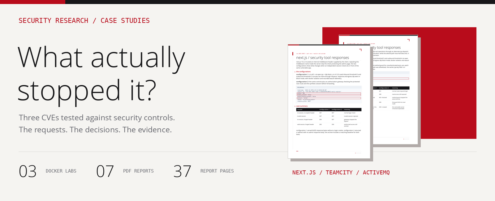

  

  <a href="#recorded-results">Results</a> ·
  <a href="#report-library">Reports</a> ·
  <a href="labs/security-control-limits/">Lab setup</a> ·
  <a href="research/app-builders/">App-builder research</a>

[Open the visual overview](index.html) after extracting the ZIP.

We tested three CVEs in Docker labs to see which controls noticed an attack, which stopped it, and which limited what happened next. A separate report reviews published security research on app builders and generated code.

**An alert does not prove prevention. One blocked payload does not prove full coverage.**

## Report library

Click a case card to open the control report. The manual reports contain the separate Burp or command-execution captures.

<table>
<tr>
<td width="33%" align="center">
 
<strong>Next.js / middleware bypass</strong> 
<a href="reports/nextjs_cve-2025-29927_report.pdf">Manual test · 3 pages</a> 
<a href="reports/nextjs_cve-2025-29927_security_controls.pdf">Control responses · 6 pages</a>
</td>
<td width="33%" align="center">
 
<strong>TeamCity / authentication bypass</strong> 
<a href="reports/teamcity_cve-2024-27198_report.pdf">Manual test · 3 pages</a> 
<a href="reports/teamcity_cve-2024-27198_security_controls.pdf">Control responses · 6 pages</a>
</td>
<td width="33%" align="center">
 
<strong>ActiveMQ / code execution</strong> 
<a href="reports/activemq_cve-2023-46604_report.pdf">Manual test · 3 pages</a> 
<a href="reports/activemq_cve-2023-46604_security_controls.pdf">Control responses · 6 pages</a>
</td>
</tr>
</table>

Manual captures and control experiments are separate evidence sets. Compare outcomes within the configuration described in each report.

### Working apps, missing checks

<table>
<tr>
<td width="47%" align="center"></td>
<td>
<strong>App builders and generated code</strong>

A review of published disclosures and studies covering Linkable, Moltbook, Base44, Escape, WordPress components, Android generators and Firebase-backed apps.

The cases focus on ownership checks, payment state, platform authentication and database settings. They do not establish that AI caused every weakness or rank builders against human developers.

<a href="reports/app_builders_security_research.pdf"><strong>Read the report · 10 pages</strong></a>  
<a href="research/app-builders/">Case summaries and original sources</a>
</td>
</tr>
</table>

## Recorded results

These results come from the control experiments. Each report keeps the application outcome separate from the sensor's decision.

| Case | Before the extra control | With the extra control | What it showed |
| :--- | :--- | :--- | :--- |
| **[Next.js](labs/security-control-limits/cases/CVE-2025-29927/)** CVE-2025-29927 | Forged middleware header returned the protected page without a session: **200** | Independent session check returned **307** | The gateway enforced the missing authorization check. |
| **[TeamCity](labs/security-control-limits/cases/CVE-2024-27198/)** CVE-2024-27198 | An unauthenticated request created a synthetic administrator: **200** | Method guard blocked the external write: **403**; bypassed reads still returned **200** | Blocking the write did not close the read bypass. |
| **[ActiveMQ](labs/security-control-limits/cases/CVE-2023-46604/)** CVE-2023-46604 | Code execution succeeded; an unrecognized **186-byte** document reached the receiver | Code execution still succeeded; segmentation made protected documents unavailable and runtime monitoring raised an alert | Containment limited the later data-access step. |

The web cases used ModSecurity CRS, inline Suricata, DLP and Docker isolation. ActiveMQ used HAProxy on the binary OpenWire path. Wazuh supplied recorded telemetry; the individual reports explain which component enforced each decision.

## Run the labs

The [lab guide](labs/security-control-limits/) covers requirements, setup, configurations and evidence collection. It includes the full command sequence; the case guides explain the policies behind `mode-a` and `mode-b`.

| Lab | Case guide | Test script |
| :--- | :--- | :--- |
| Next.js 15.2.2 | [Session enforcement](labs/security-control-limits/cases/CVE-2025-29927/) | [test.sh](labs/security-control-limits/cases/CVE-2025-29927/scripts/test.sh) |
| TeamCity 2023.11.3 | [Routing and method guard](labs/security-control-limits/cases/CVE-2024-27198/) | [test.sh](labs/security-control-limits/cases/CVE-2024-27198/scripts/test.sh) |
| ActiveMQ 5.17.3 | [OpenWire and containment](labs/security-control-limits/cases/CVE-2023-46604/) | [test.sh](labs/security-control-limits/cases/CVE-2023-46604/scripts/test.sh) |

<strong>Files and evidence</strong>

| Location | Contents |
| :--- | :--- |
| [`reports/`](reports/) | Seven PDF reports with screenshots, findings and references |
| [`labs/security-control-limits/`](labs/security-control-limits/) | Docker Compose source, control policies, test scripts and evidence helpers |
| [`research/app-builders/`](research/app-builders/) | Published case summaries and source links |
| [`logs/three_cve_logs_available_records.txt`](logs/three_cve_logs_available_records.txt) | Available historical log records supplied with this project |

The receiver is a lab container. Root inside the ActiveMQ container does not establish host compromise. Patched-reference helpers are test utilities; their presence does not establish that every reference was run.

## Members

| Researcher | Work | Links |
| :--- | :--- | :--- |
| **Mohamed Salah** | Security researcher / penetration tester | [LinkedIn](https://www.linkedin.com/in/mohamed-salah-3a0498248/) · [HackerOne](https://hackerone.com/lightofthemoon) · [Hack The Box](https://app.hackthebox.com/profile/2354735) |
| **Ahmed Hatem** | Web pentester | [LinkedIn](https://www.linkedin.com/in/ahmed-hatem-0530742b2) |
