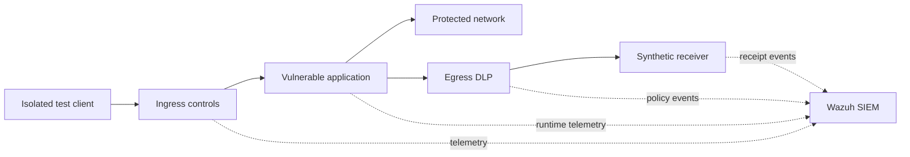
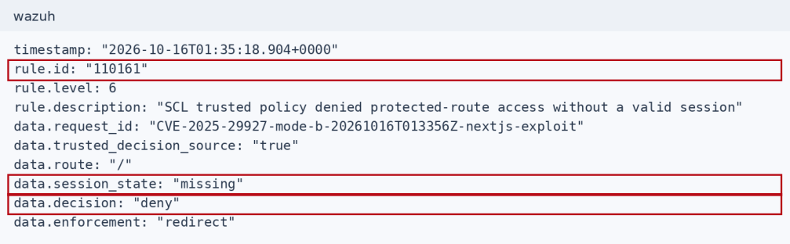
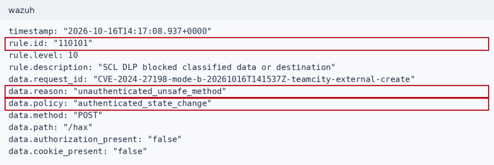

  

<h1 align="center">Security Research Case Studies</h1>

<strong>Digital Egypt Pioneers Initiative (DEPI) · Vulnerability Analysis &amp; Penetration Testing</strong>

  <a href="#objective-1--security-control-limits">Objective 01</a> ·
  <a href="#objective-2--application-development-security">Objective 02</a> ·
  <a href="cases/README.md">Case files</a> ·
  <a href="reports/README.md">Reports</a> ·
  <a href="evidence/README.md">Evidence</a> ·
  <a href="labs/security-control-limits/README.md">Lab setup</a> ·
  <a href="references/README.md">Sources</a>

Two research objectives: **test security control limits** in isolated labs and **compare documented vulnerability patterns** across development approaches.

---

## Objective 1 — Security control limits

**Research question:** What can security controls see, stop or contain when an application is vulnerable?

### Case files

<table>
<tr>
<td width="33%" align="center"> <strong>Next.js</strong> <code>CVE-2025-29927</code> Middleware authorization bypass  <a href="cases/nextjs.md"><strong>Open case study →</strong></a> <a href="reports/nextjs_cve-2025-29927_report.pdf">Manual report</a> · <a href="reports/nextjs_cve-2025-29927_security_controls.pdf">Controls report</a></td>
<td width="33%" align="center"> <strong>TeamCity</strong> <code>CVE-2024-27198</code> Authentication bypass  <a href="cases/teamcity.md"><strong>Open case study →</strong></a> <a href="reports/teamcity_cve-2024-27198_report.pdf">Manual report</a> · <a href="reports/teamcity_cve-2024-27198_security_controls.pdf">Controls report</a></td>
<td width="33%" align="center"> <strong>ActiveMQ</strong> <code>CVE-2023-46604</code> Remote code execution  <a href="cases/activemq.md"><strong>Open case study →</strong></a> <a href="reports/activemq_cve-2023-46604_report.pdf">Manual report</a> · <a href="reports/activemq_cve-2023-46604_security_controls.pdf">Controls report</a></td>
</tr>
</table>

### Recorded results

| Case | Configuration 1 | Configuration 2 | Conclusion |
| :--- | :--- | :--- | :--- |
| [Next.js](cases/nextjs.md) | Protected page returned without a session: **200** | Independent session check redirected: **307** | Application-aware authorization prevented the tested bypass. |
| [TeamCity](cases/teamcity.md) | Unauthenticated administrator creation: **200** | External write blocked: **403**; bypassed reads still **200** | Partial prevention, not complete authorization repair. |
| [ActiveMQ](cases/activemq.md) | RCE succeeded; unrecognized 186-byte document reached the receiver | RCE still succeeded; protected documents unavailable; runtime alarm | Segmentation contained the later document-access step. |

### What the controls can see and do

| Control | What it observed in these experiments | What it actually did / limitation |
| :--- | :--- | :--- |
| ModSecurity / OWASP CRS | HTTP requests, anomaly scores and rule matches | Blocked a separate TeamCity static-asset request; did not reliably prevent the tested bypasses. Not on ActiveMQ's OpenWire path. |
| Suricata IPS | Network signatures and positive-control probes | Dropped designated test probes; recorded TeamCity and ActiveMQ exploit signatures as **allowed**. No CVE-specific alert was recorded for the Next.js bypass. |
| Wazuh SIEM | Sensor alerts, authorization decisions, DLP and runtime telemetry | Correlated and reported events; no independent prevention established. |
| DLP gateways | Known content markers, request/response metadata and receiver records | Blocked recognized samples; unrecognized and Base64 classifier probes passed. ActiveMQ's unrecognized attack-linked document also passed in configuration 1. |
| Independent authorization / method guard | Session state in Next.js; missing credential indicators on TeamCity writes | Next.js denied the tested unauthenticated access; TeamCity blocked unauthenticated writes while reads remained exposed. |
| Docker segmentation | Network memberships and downstream access outcomes | Removed ActiveMQ's access to the protected network; did not prevent RCE. |
| Runtime monitor | Unexpected Java child processes | Detected behavior after execution; did not stop the shell. |

> [!IMPORTANT]
> An alert does not prove prevention. A blocked probe does not prove full coverage. A receiver event does not by itself prove data theft. The results apply to the recorded configurations, not every deployment of these tools.

### Research workflow

Conceptual topology: web cases use HTTP controls; ActiveMQ uses HAProxy on the binary OpenWire path. Actual connectivity and policies differ by configuration.

[Lab source and setup](labs/security-control-limits/README.md) · [Six experimental reports](reports/README.md) · [Recorded evidence](evidence/README.md)

---

## Objective 2 — Application development security

**Research question:** What types of vulnerabilities appear in vibe coding, traditional app builders and human-written applications?

<table><tr>
<td width="44%" align="center"></td>
<td valign="middle"><strong>Working apps, missing checks</strong>  Published disclosures and studies covering authorization, payment integrity, shared platform authentication, generated Android components and deployment configuration.  <a href="cases/app-builders.md"><strong>Open research case study →</strong></a> <a href="reports/app_builders_security_research.pdf">Full research report · 10 pages</a> <a href="research/app-builders/README.md">Published source index</a></td>
</tr></table>

### Vulnerability types by development approach

| Vulnerability | Vibe coding / AI-assisted | Traditional app builders | Human-written / conventional |
| :--- | :--- | :--- | :--- |
| Broken access control | Linkable, Moltbook, Lovable | Elementor authorization flaws | Missing ownership or role checks |
| Authentication bypass | Base44 shared platform flaw | Elementor password-reset flaw | Incorrect login or recovery checks |
| Business logic | Linkable payment-state manipulation | Unsafe visual workflows | Incorrect transaction validation |
| Data / secret exposure | Moltbook, Escape, Lovable | Elementor API key exposure | Hardcoded secrets or unrestricted data |
| Injection and file handling | SQL injection and path traversal in controlled programming tasks | XSS, file inclusion, object injection in shared plugins | SQL injection and path traversal in conventional products |
| Android and shared components | Generated dependencies require review | Unsafe WebViews, exported components, shared templates | Unsafe native components or dependencies |

Examples combine disclosures, controlled studies and recognized risks. They do not establish comparative prevalence. Firebase deployment examples have unknown development methods. AI-powered hosted builders overlap both builder and AI categories.

[Full 12-category comparison with CWE mappings, evidence labels and 14 references](cases/app-builders.md#vulnerability-types-by-development-approach)

### Published research highlights

| Research | Key finding |
| :--- | :--- |
| [Linkable — Matt Palmer (2025)](https://mattpalmer.io/posts/2025/05/statement-on-CVE-2025-48757/) | Unauthorized record insertion with paid state; no Stripe compromise demonstrated. |
| [Moltbook — Wiz (2026)](https://www.wiz.io/blog/exposed-moltbook-database-reveals-millions-of-api-keys) | Database and token exposure; unauthorized modifications. |
| [Base44 — Wiz (2025)](https://www.wiz.io/blog/critical-vulnerability-base44) | Private-application registration bypass in the shared platform. |
| [Lovable — Crissy Field (2026)](https://www.crissyfield.de/research/lovable-en/) | 159,041 projects analyzed; 7,403 of 24,664 closely examined sites returned tables containing email addresses. Sensitive data exposure confirmed in individual cases. |
| [Escape (2025)](https://escape.tech/blog/methodology-how-we-discovered-vulnerabilities-apps-built-with-vibe-coding/) | Exposed secrets and data in publicly deployed vibe-coded applications. |
| [Elementor — Patchstack (2023)](https://patchstack.com/articles/critical-privilege-escalation-in-essential-addons-for-elementor-plugin-affecting-1-million-sites/) | Missing password-reset key validation, CVE-2023-32243. |
| [Android generators — IEEE S&P (2018)](https://doi.org/10.1109/SP.2018.00005) | Shared generated components and insecure configuration; historical findings. |
| [AI assistance — ACM CCS (2023)](https://doi.org/10.1145/3576915.3623157) | Controlled study: 36% vs. 7% SQL-injectable solutions in one task (AI-assisted vs. non-AI). Small sample, older model. |

Lovable's 7,403/24,664 observation is **not a confirmed data leak rate**; the sample was not representative of all Lovable apps. See the [full research case](cases/app-builders.md) for scope, limitations and sources.

### Security boundaries to verify before release

| Boundary | Required behavior |
| :--- | :--- |
| Identity and membership | Registration, login and recovery must enforce the same private-access policy. |
| Ownership and permissions | Verify the caller's rights for every read, insert, update and delete. |
| Business logic | Only trusted processing may change sensitive payment or order states. |
| Shared components | Review plugin handlers, native bridges, exported components and generated templates. |
| Deployment configuration | Deny public access by default; validate backend policies and keep secrets out of public data. |

[Read the detailed comparison](cases/app-builders.md) · [Published evidence](evidence/app-builders/README.md)

---

## Evidence at a glance

<table>
<tr>
<td width="33%" align="center"> <a href="evidence/nextjs/README.md">Next.js evidence</a></td>
<td width="33%" align="center"> <a href="evidence/teamcity/README.md">TeamCity evidence</a></td>
<td width="33%" align="center"> <a href="evidence/activemq/README.md">ActiveMQ evidence</a></td>
</tr>
</table>

[Published app-builder captures](evidence/app-builders/README.md) · [All evidence](evidence/README.md) · [Recorded log archive](logs/three_cve_logs_available_records.txt)

## Report and evidence library

| Resource | Contents |
| :--- | :--- |
| [Case files](cases/README.md) | Four GitHub-readable research pages, with results, images and sources. |
| [PDF reports](reports/README.md) | Seven original reports: three manual, three control response, one published research. |
| [Evidence library](evidence/README.md) | 45 report captures, expandable galleries and source-page mappings. |
| [Archive records](evidence/manifest.json) | Five selected JSON records with provenance and hashes. |
| [Historical log archive](logs/three_cve_logs_available_records.txt) | Available original project log records. |
| [Lab source](labs/security-control-limits/README.md) | Docker Compose, control policies, test helpers and evidence collection. |
| [References](references/README.md) | Dated advisories and original publications. |

Manual captures and control experiments are separate evidence sets. Published disclosures are third-party research, not lab reproductions. Correlate matching experiment IDs and distinguish application outcomes from sensor decisions.

## Members

| Researcher | Work | Links |
| :--- | :--- | :--- |
| **Mohamed Salah** | Security researcher / penetration tester | [LinkedIn](https://www.linkedin.com/in/mohamed-salah-3a0498248/) · [HackerOne](https://hackerone.com/lightofthemoon) · [Hack The Box](https://app.hackthebox.com/profile/2354735) |
| **Ahmed Hatem** | Web pentester | [LinkedIn](https://www.linkedin.com/in/ahmed-hatem-0530742b2) |

[Product logo sources](assets/logos/README.md)
