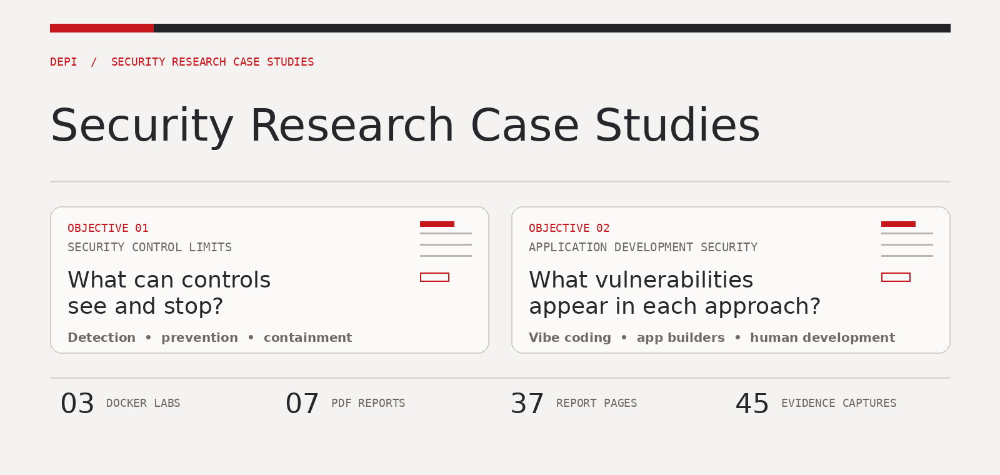

  

<h1 align="center">Security Research Case Studies</h1>

<strong>Digital Egypt Pioneers Initiative (DEPI) · Vulnerability Analysis &amp; Penetration Testing</strong>

  <a href="cases/README.md">Case files</a> ·
  <a href="reports/README.md">Reports</a> ·
  <a href="evidence/README.md">Evidence</a> ·
  <a href="references/README.md">Sources</a>

A compact research portfolio built around two questions:

- **What can security controls actually detect, block or contain?**
- **What vulnerability patterns appear across different development approaches?**

---

## Objective 01 — Security control limits

Three CVEs were reproduced in Docker labs to compare detection, prevention and containment across different control layers.

| Case | Focus | Files |
| :--- | :--- | :--- |
| [Next.js](cases/nextjs.md) | Middleware authorization bypass | [Manual](reports/nextjs_cve-2025-29927_report.pdf) · [Controls](reports/nextjs_cve-2025-29927_security_controls.pdf) |
| [TeamCity](cases/teamcity.md) | Authentication bypass | [Manual](reports/teamcity_cve-2024-27198_report.pdf) · [Controls](reports/teamcity_cve-2024-27198_security_controls.pdf) |
| [ActiveMQ](cases/activemq.md) | Remote code execution | [Manual](reports/activemq_cve-2023-46604_report.pdf) · [Controls](reports/activemq_cve-2023-46604_security_controls.pdf) |

### Control summary

| Control | Practical takeaway |
| :--- | :--- |
| ModSecurity / CRS | Useful for HTTP inspection, but did not fully stop the tested bypasses. |
| Suricata IPS | Detected test probes and signatures, but did not consistently prevent the exploits. |
| Wazuh SIEM | Good for evidence correlation, not a standalone prevention layer. |
| DLP | Blocked recognized content, but unknown content could still pass. |
| Authorization checks | Most effective where the application enforced its own trust boundary. |
| Segmentation | Strong for containment, not for preventing initial exploitation. |

---

## Objective 02 — Application development security

A source-backed comparison of recurring vulnerabilities across **vibe coding**, **app builders**, and **human development / deployment**.

<table><tr>
<td width="44%" align="center"></td>
<td valign="middle"><strong>Working apps, missing checks</strong>  Published examples focused on access control, data exposure, business logic, shared components and deployment mistakes.  <a href="cases/app-builders.md"><strong>Open case study →</strong></a> <a href="reports/app_builders_security_research.pdf">Full report</a></td>
</tr></table>

### Development-approach summary

| Approach | Typical weakness pattern |
| :--- | :--- |
| Vibe coding | Over-trusted generated logic, weak authorization, exposed records |
| App builders | Shared platform flaws, plugin risk, insecure defaults |
| Human development / deployment | Access-control mistakes, misconfiguration, insecure implementation |

---

## Project structure

| Path | Purpose |
| :--- | :--- |
| [`cases/`](cases/README.md) | GitHub-readable case studies |
| [`reports/`](reports/README.md) | Seven PDF reports |
| [`evidence/`](evidence/README.md) | Evidence captures and mappings |
| [`references/`](references/README.md) | Publication list |
| [`labs/security-control-limits/`](labs/security-control-limits/README.md) | Docker lab source |
| [`research/app-builders/`](research/app-builders/README.md) | Source notes for Objective 02 |

## Notes

- The three CVE cases were reproduced in isolated lab environments.
- The app-builders case is a literature and disclosure review.
- Visual design was simplified in this edition for cleaner GitHub presentation.
