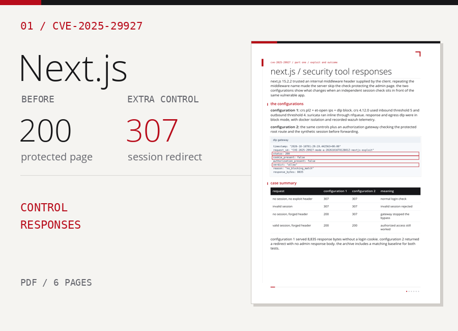
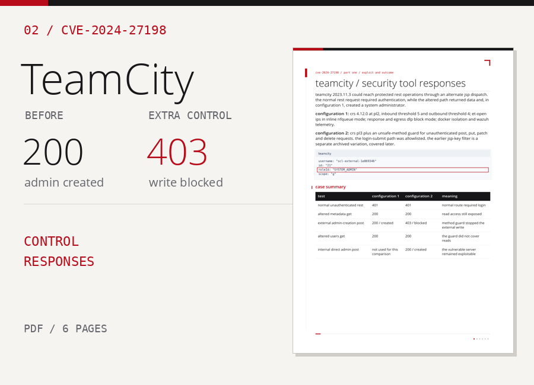
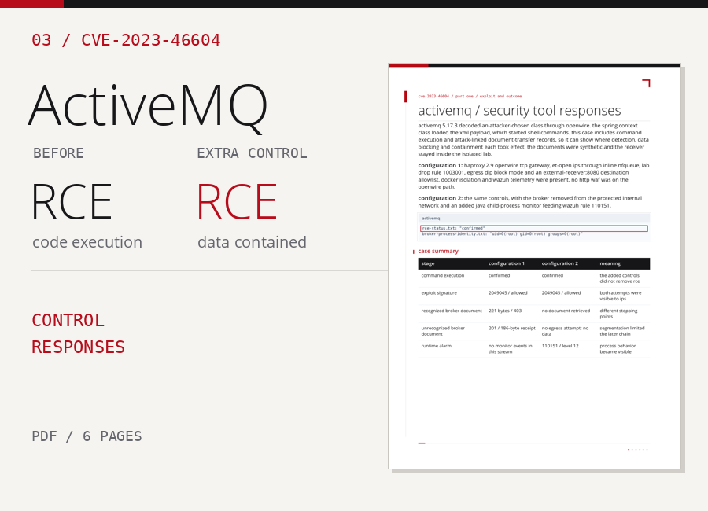
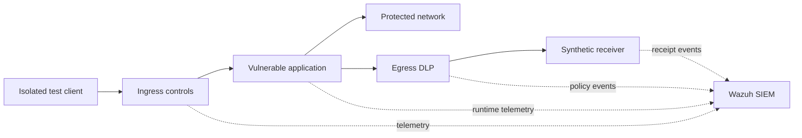
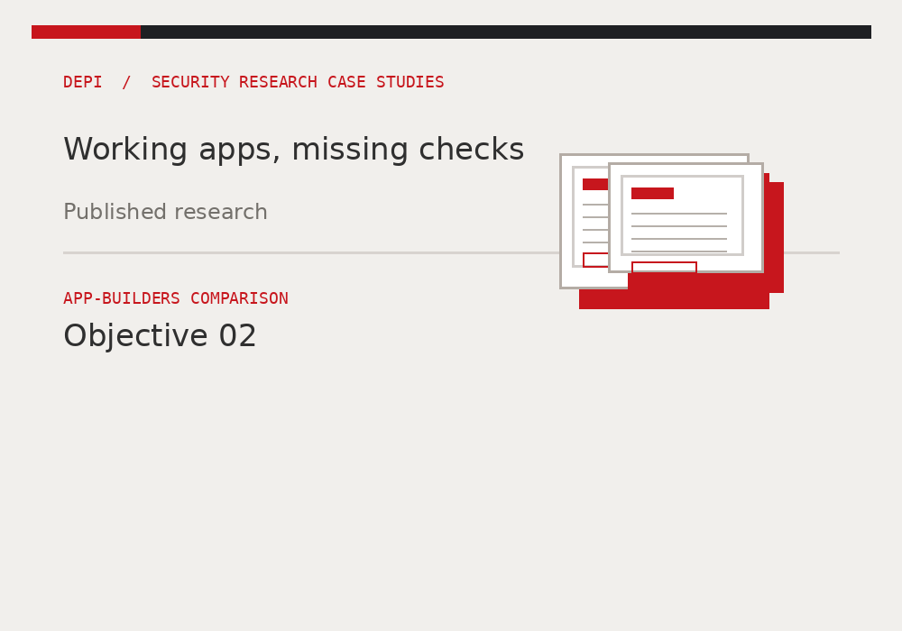

  

<h1 align="center">Security Research Case Studies</h1>

<strong>Digital Egypt Pioneers Initiative (DEPI) · Vulnerability Analysis &amp; Penetration Testing</strong>

  <a href="#objective-1--security-control-limits">Objective 01</a> ·
  <a href="#objective-2--application-development-security">Objective 02</a> ·
  <a href="cases/README.md">Case files</a> ·
  <a href="reports/README.md">Reports</a> ·
  <a href="evidence/README.md">Evidence</a> ·
  <a href="labs/security-control-limits/README.md">Lab setup</a> ·
  <a href="references/README.md">Sources</a>

This project explores two related security questions: whether layered controls can detect or stop exploitation of a vulnerable application, and what security weaknesses are documented across different application development approaches.

<table>
<tr>
<td width="50%" valign="top">
<strong>01 / EXPERIMENTAL RESEARCH</strong>  
<strong>What can security controls see and do?</strong> 
Three CVEs reproduced in isolated Docker labs. Compare observed detection, prevention, containment and data movement across two configurations.  
<a href="#objective-1--security-control-limits"><strong>Explore control limits →</strong></a>
</td>
<td width="50%" valign="top">
<strong>02 / PUBLISHED RESEARCH</strong>  
<strong>What types of vulnerabilities appear in each development approach?</strong> 
Compare published findings involving AI-generated applications, visual builders, Android generators and manual development or deployment decisions.  
<a href="#objective-2--application-development-security"><strong>Explore development risks →</strong></a>
</td>
</tr>
</table>

---

## Objective 1 — Security control limits

**Research question:** What can a WAF, IPS, SIEM, DLP, application-aware policy and network segmentation actually observe, prevent or contain when the underlying application is vulnerable?

### Case files

<table>
<tr>
<td width="33%" align="center"> <strong>Next.js</strong> <code>CVE-2025-29927</code> Middleware authorization bypass  <a href="cases/nextjs.md"><strong>Open case study →</strong></a> <a href="reports/nextjs_cve-2025-29927_report.pdf">Manual report</a> · <a href="reports/nextjs_cve-2025-29927_security_controls.pdf">Controls report</a></td>
<td width="33%" align="center"> <strong>TeamCity</strong> <code>CVE-2024-27198</code> Authentication bypass  <a href="cases/teamcity.md"><strong>Open case study →</strong></a> <a href="reports/teamcity_cve-2024-27198_report.pdf">Manual report</a> · <a href="reports/teamcity_cve-2024-27198_security_controls.pdf">Controls report</a></td>
<td width="33%" align="center"> <strong>ActiveMQ</strong> <code>CVE-2023-46604</code> Remote code execution  <a href="cases/activemq.md"><strong>Open case study →</strong></a> <a href="reports/activemq_cve-2023-46604_report.pdf">Manual report</a> · <a href="reports/activemq_cve-2023-46604_security_controls.pdf">Controls report</a></td>
</tr>
</table>

### Recorded results

| Case | Configuration 1 | Configuration 2 | Conclusion |
| :--- | :--- | :--- | :--- |
| [Next.js](cases/nextjs.md) | Protected page returned without a session: **200** | Independent session check redirected: **307** | Application-aware authorization prevented the tested bypass. |
| [TeamCity](cases/teamcity.md) | Unauthenticated administrator creation: **200** | External write blocked: **403**; bypassed reads still **200** | Partial prevention, not complete authorization repair. |
| [ActiveMQ](cases/activemq.md) | RCE succeeded; unrecognized 186-byte document reached the receiver | RCE still succeeded; protected documents unavailable; runtime alarm | Segmentation contained the later document-access step. |

### What the controls can see and do

| Control | What it observed in these experiments | What it actually did / limitation |
| :--- | :--- | :--- |
| ModSecurity / OWASP CRS | HTTP requests, anomaly scores and rule matches | Blocked a separate TeamCity static-asset request; did not reliably prevent the tested bypasses. Not on ActiveMQ's OpenWire path. |
| Suricata IPS | Network signatures and positive-control probes | Dropped designated test probes; recorded TeamCity and ActiveMQ exploit signatures as **allowed**. No CVE-specific alert was recorded for the Next.js bypass. |
| Wazuh SIEM | Sensor alerts, authorization decisions, DLP and runtime telemetry | Correlated and reported events; no independent prevention established. |
| DLP gateways | Known content markers, request/response metadata and receiver records | Blocked recognized samples; unrecognized and Base64 classifier probes passed. ActiveMQ's unrecognized attack-linked document also passed in configuration 1. |
| Independent authorization / method guard | Session state in Next.js; missing credential indicators on TeamCity writes | Next.js denied the tested unauthenticated access; TeamCity blocked unauthenticated writes while reads remained exposed. |
| Docker segmentation | Network memberships and downstream access outcomes | Removed ActiveMQ's access to the protected network; did not prevent RCE. |
| Runtime monitor | Unexpected Java child processes | Detected behavior after execution; did not stop the shell. |

> [!IMPORTANT]
> An alert does not prove prevention. A blocked probe does not prove full coverage. A receiver event does not by itself prove data theft. The results apply to the recorded configurations, not every deployment of these tools.

### Research workflow

Conceptual topology: web cases use HTTP controls; ActiveMQ uses HAProxy on the binary OpenWire path. Actual connectivity and policies differ by configuration.

[Lab source and setup](labs/security-control-limits/README.md) · [Six experimental reports](reports/README.md) · [Recorded evidence](evidence/README.md)

---

## Objective 2 — Application development security

**Research question:** What vulnerability classes are documented in applications built with AI assistance, low-code/no-code or visual builders, mobile generators, and conventional development or deployment practices? Which trust boundaries were missing, and how should they be verified?

<table><tr>
<td width="44%" align="center"></td>
<td valign="middle"><strong>Working apps, missing checks</strong>  Published disclosures and studies covering authorization, payment integrity, shared platform authentication, generated Android components and deployment configuration.  <a href="cases/app-builders.md"><strong>Open research case study →</strong></a> <a href="reports/app_builders_security_research.pdf">Full research report · 10 pages</a> <a href="research/app-builders/README.md">Published source index</a></td>
</tr></table>

### Vulnerability types by development approach

| Approach / context | Published examples | Documented vulnerability classes |
| :--- | :--- | :--- |
| AI-built web applications | Linkable, Moltbook | Broken access control, unauthorized database writes, payment-state manipulation, sensitive data exposure, broken record ownership. |
| AI-assisted / hosted builder platforms | Base44, Escape's deployed app sample | Private-application access bypass, weak backend access controls, exposed secrets and personal data. |
| Visual builders and reusable plugins | Essential Addons for Elementor | Missing password-reset validation; unauthenticated privilege escalation / account takeover risk. |
| Android app generators | Oltrogge et al. (2018) | Unprotected configuration, unsafe WebView behavior, exposed components and shared-template weaknesses. |
| Mobile deployment / conventional development context | Firebase exposure study; Perry et al. AI-assistance comparison | Public database access and missing ownership checks; insecure programming solutions in a controlled study. Firebase cases have unknown development methods. |

The categories overlap. The published cases identify recurring failure modes, not an exclusive list of flaws for each approach or a measured vulnerability rate. The study does not establish that AI caused every weakness or that one approach is universally more secure than another.

### Security boundaries to verify before release

| Boundary | Required behavior |
| :--- | :--- |
| Identity and membership | Registration, login and recovery must enforce the same private-access policy. |
| Ownership and permissions | Verify the caller's rights for every read, insert, update and delete. |
| Business logic | Only trusted processing may change sensitive payment or order states. |
| Shared components | Review plugin handlers, native bridges, exported components and generated templates. |
| Deployment configuration | Deny public access by default; validate backend policies and keep secrets out of public data. |

[Read the detailed comparison](cases/app-builders.md) · [Published evidence](evidence/app-builders/README.md)

---

## Report and evidence library

| Resource | Contents |
| :--- | :--- |
| [Case files](cases/README.md) | Four GitHub-readable research pages, with results, images and sources. |
| [PDF reports](reports/README.md) | Seven original reports: three manual, three control response, one published research. |
| [Evidence library](evidence/README.md) | 45 report captures, expandable galleries and source-page mappings. |
| [Archive records](evidence/manifest.json) | Five selected JSON records with provenance and hashes. |
| [Historical log archive](logs/three_cve_logs_available_records.txt) | Available original project log records. |
| [Lab source](labs/security-control-limits/README.md) | Docker Compose, control policies, test helpers and evidence collection. |
| [References](references/README.md) | Dated advisories and original publications. |

Manual captures and control experiments are separate evidence sets. Published disclosures are third-party research, not lab reproductions. Correlate matching experiment IDs and distinguish application outcomes from sensor decisions.

## Members

| Researcher | Work | Links |
| :--- | :--- | :--- |
| **Mohamed Salah** | Security researcher / penetration tester | [LinkedIn](https://www.linkedin.com/in/mohamed-salah-3a0498248/) · [HackerOne](https://hackerone.com/lightofthemoon) · [Hack The Box](https://app.hackthebox.com/profile/2354735) |
| **Ahmed Hatem** | Web pentester | [LinkedIn](https://www.linkedin.com/in/ahmed-hatem-0530742b2) |

[Product logo sources](assets/logos/README.md)
