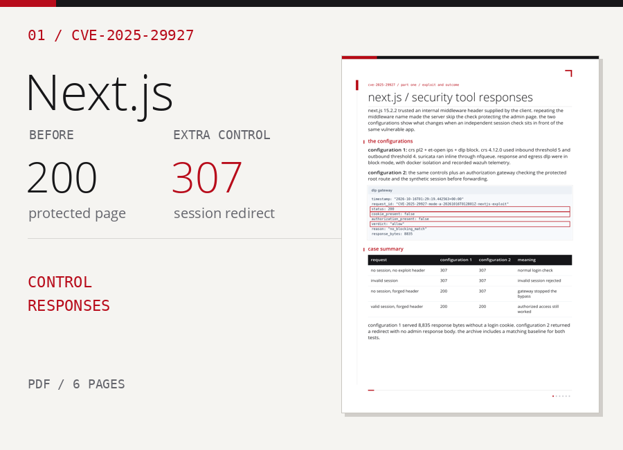
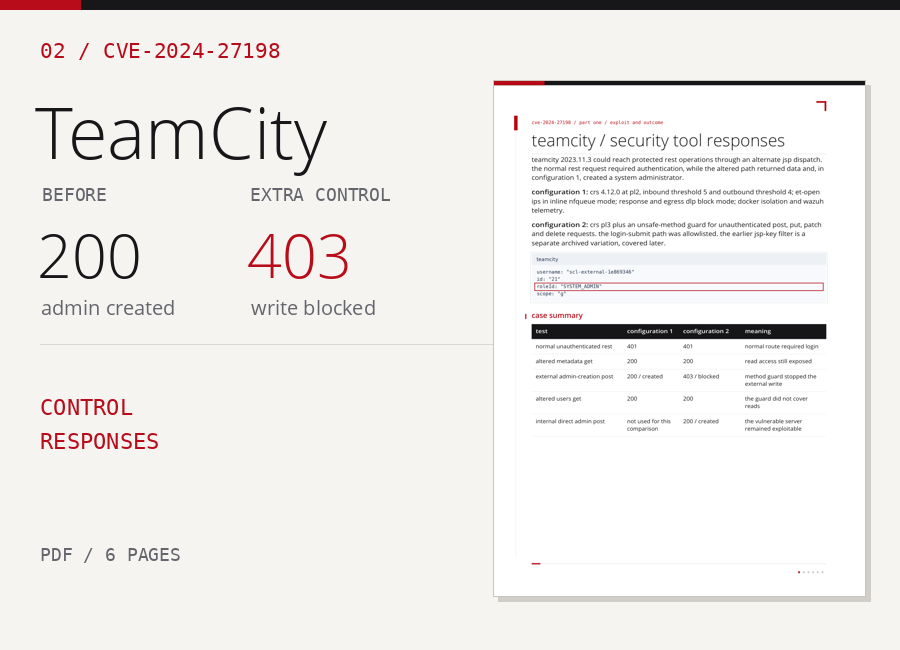
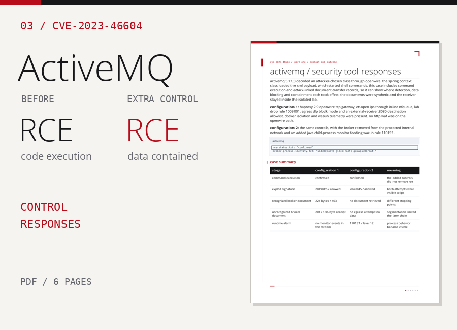
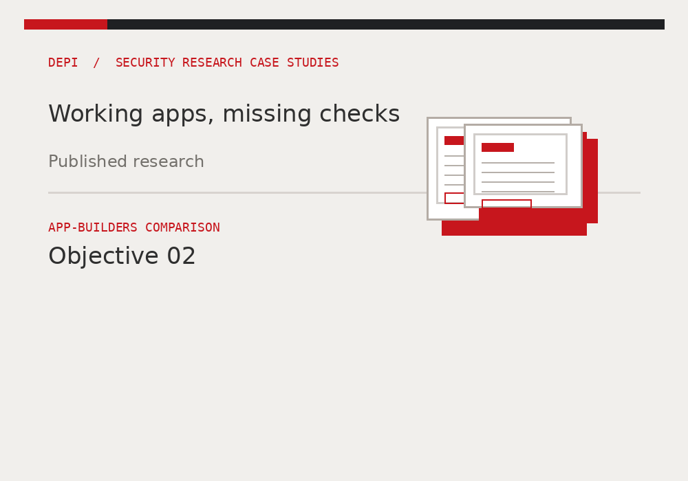

[← Project overview](../README.md) · [Reports](../reports/README.md) · [Evidence](../evidence/README.md)

# Research case files

Four case pages designed for GitHub's native Markdown renderer. Open a card to read the findings, view evidence and browse original sources without running a website.

<table>
<tr><td width="50%" align="center"> <strong>01 / Next.js</strong> <code>CVE-2025-29927</code> <a href="nextjs.md">Open case →</a></td><td width="50%" align="center"> <strong>02 / TeamCity</strong> <code>CVE-2024-27198</code> <a href="teamcity.md">Open case →</a></td></tr>
<tr><td align="center"> <strong>03 / ActiveMQ</strong> <code>CVE-2023-46604</code> <a href="activemq.md">Open case →</a></td><td align="center"> <strong>04 / App builders</strong> Published research <a href="app-builders.md">Open case →</a></td></tr>
</table>
