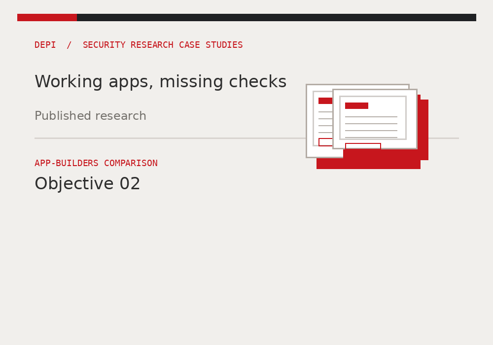
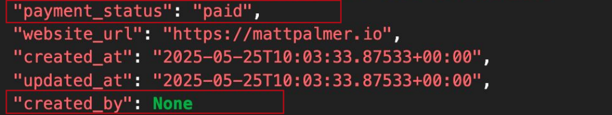
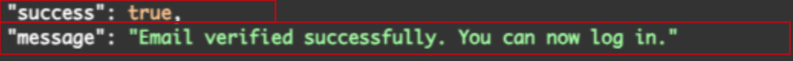
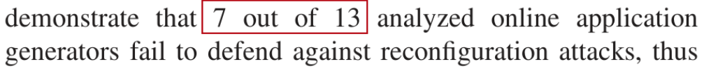
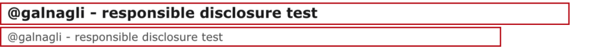
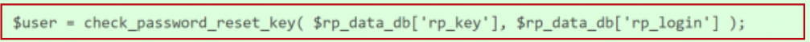
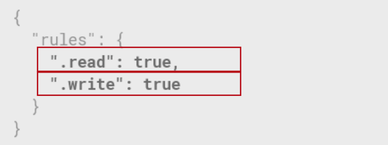

[← Project overview](../README.md) · [All cases](README.md) · [Published sources](../references/README.md)

# App builders and generated code

**OBJECTIVE 02 — PUBLISHED RESEARCH** · Application development security

<table><tr><td width="44%"></td><td><strong>Working apps, missing checks.</strong>  Compare recurring security failures at backend, platform, component and deployment boundaries. This is a literature and disclosure review, not a set of reproduced lab exploits.  6 published evidence captures · 10 report pages  <a href="../reports/app_builders_security_research.pdf">Read the full report</a> · <a href="../research/app-builders/README.md">Original source index</a></td></tr></table>

## Vulnerability types by development approach

The comparison below answers Objective 02: **which types of vulnerabilities have been documented, and where can the development approach introduce or propagate them?**

| Vibe coding | Traditional app builders | Human-written development |
| :--- | :--- | :--- |
| Prompt-driven implementation with substantial AI-generated code and limited manual review. | Visual, template-based or low-code development, including WordPress page builders and Android generators. | Developers directly implement and review application logic, APIs and integrations. |
| Review generated code, inferred requirements and backend policy. | Review platform defaults, shared plugins, templates and generated native components. | Review implementation, architecture, dependencies and deployment. |

**Evidence key:** **Documented** = a published incident, disclosure or study in the indicated context; **Study** = controlled programming-task evidence, not a deployed-app incident; **Risk** = recognized security weakness to test for, without an approach-specific example in the selected sources; **—** = no specific evidence in this review, not proof of immunity. Numbers link to references at the bottom of this page. CWE identifiers are analyst mappings, not necessarily the original advisory's assigned CWE.

| Vulnerability type | Vibe coding / AI-assisted | Traditional app builders | Human-written / conventional development |
| :--- | :--- | :--- | :--- |
| **Broken access control** (CWE-862, CWE-639) | **Documented:** Linkable allowed unauthorized data access; Moltbook exposed database read/write operations. [R1](#references--three-way-vulnerability-comparison) [R2](#references--three-way-vulnerability-comparison) | **Documented:** missing authorization in shared Elementor add-on functionality. [R4](#references--three-way-vulnerability-comparison) | **Risk:** omitted server-side role or object-ownership checks. [R7](#references--three-way-vulnerability-comparison) |
| **Authentication bypass / account takeover** (CWE-287, CWE-640) | **Documented:** Base44 allowed registration into private applications through a shared platform flaw, not necessarily generated application code. [R3](#references--three-way-vulnerability-comparison) | **Documented:** Essential Addons for Elementor reset passwords without validating the reset key (CVE-2023-32243). [R5](#references--three-way-vulnerability-comparison) | **Risk:** incorrect login, session or password-recovery checks. [R7](#references--three-way-vulnerability-comparison) |
| **Business logic flaws** (CWE-840 family) | **Documented:** Linkable accepted an unauthorized record marked paid; no Stripe compromise was demonstrated. [R1](#references--three-way-vulnerability-comparison) | **Risk:** visual workflows may omit server-side validation of price, payment or state transitions. [R7](#references--three-way-vulnerability-comparison) | **Risk:** incorrect workflow or transaction-state enforcement. [R7](#references--three-way-vulnerability-comparison) |
| **Sensitive data / secret exposure** (CWE-200, CWE-798) | **Documented:** Escape found exposed secrets in deployed vibe-coded apps; Moltbook exposed private data and authentication tokens. [R2](#references--three-way-vulnerability-comparison) [R6](#references--three-way-vulnerability-comparison) | **Documented:** Elementor add-on exposed a Mailchimp API key; other information-disclosure flaws are recorded. [R4](#references--three-way-vulnerability-comparison) | **Risk:** credentials in source, logs or responses; inadequate access restrictions. [R7](#references--three-way-vulnerability-comparison) |
| **Security misconfiguration** (CWE-16 category) | **Documented:** Moltbook lacked effective database row-level authorization. A public Supabase key alone is not a vulnerability. [R2](#references--three-way-vulnerability-comparison) | **Documented:** historical Android generator research identified security weaknesses in shared configuration and generated components. [R8](#references--three-way-vulnerability-comparison) | **Risk:** unsafe defaults, permissive access policies or exposed services. [R7](#references--three-way-vulnerability-comparison) |
| **SQL injection** (CWE-89) | **Study:** AI-assisted participants submitted SQL-injectable solutions in the Perry et al. experiment. [R9](#references--three-way-vulnerability-comparison) | **Risk:** unsafe custom queries or plugin input processing; no builder-specific SQLi case cited here. [R7](#references--three-way-vulnerability-comparison) | **Study / documented:** non-AI control participants also submitted SQL-injectable code; MOVEit Transfer had SQLi (CVE-2023-34362). [R9](#references--three-way-vulnerability-comparison) [R10](#references--three-way-vulnerability-comparison) |
| **Cross-site scripting (XSS)** (CWE-79) | **Risk:** generated rendering code may mishandle untrusted HTML. [R7](#references--three-way-vulnerability-comparison) | **Documented:** stored and reflected XSS in Elementor add-on widgets. [R4](#references--three-way-vulnerability-comparison) | **Risk:** untrusted data rendered without context-appropriate encoding. [R7](#references--three-way-vulnerability-comparison) |
| **File path traversal / inclusion** (CWE-22, CWE-98) | **Study:** AI-assisted participants had difficulty enforcing sandboxed directory boundaries. [R9](#references--three-way-vulnerability-comparison) | **Documented:** local file inclusion in Essential Addons for Elementor (fixed in the 5.0.x series). [R4](#references--three-way-vulnerability-comparison) | **Study / documented:** non-AI control participants also failed directory-security tasks; Apache HTTP Server CVE-2021-42013 is a path traversal example. [R9](#references--three-way-vulnerability-comparison) [R11](#references--three-way-vulnerability-comparison) |
| **Insecure cryptography** (CWE-327, CWE-330) | **Study:** insecure encryption and message-signing solutions, including unsafe randomness, in AI-assisted tasks. [R9](#references--three-way-vulnerability-comparison) | **Documented:** historical Android generator study reports insecure random-number generation. [R8](#references--three-way-vulnerability-comparison) | **Study:** non-AI participants also produced insecure cryptographic solutions. [R9](#references--three-way-vulnerability-comparison) |
| **Unsafe deserialization / object injection** (CWE-502) | **Risk:** generated code may deserialize untrusted objects. [R7](#references--three-way-vulnerability-comparison) | **Documented:** PHP object injection in an Elementor add-on password-reset error handler. [R4](#references--three-way-vulnerability-comparison) | **Risk:** unsafe deserialization of untrusted input. [R7](#references--three-way-vulnerability-comparison) |
| **Exposed native components / WebView trust** (CWE-926, CWE-749) | — | **Documented:** Android app generator research identified shared native-component and WebView security weaknesses. [R8](#references--three-way-vulnerability-comparison) | **Risk:** exported components and WebView bridges need explicit trust and permission checks; see the Android security baseline. [R12](#references--three-way-vulnerability-comparison) |
| **Shared component / dependency risk** (OWASP A03:2025) | **Risk:** unreviewed dependencies and hosted services; Base44 illustrates shared-platform exposure. [R3](#references--three-way-vulnerability-comparison) [R7](#references--three-way-vulnerability-comparison) | **Documented:** a reusable vulnerable plugin can expose every affected installation; Android generators can propagate shared weaknesses. [R5](#references--three-way-vulnerability-comparison) [R8](#references--three-way-vulnerability-comparison) | **Risk:** vulnerable libraries, build tools and update chains. [R7](#references--three-way-vulnerability-comparison) |

### What the evidence establishes

| Development approach | Distinctive review priority | Security consequence |
| :--- | :--- | :--- |
| Vibe coding | Verify generated authorization, business rules and actual backend permissions independently of UI behavior. | A functional interface can conceal unauthorized access or unsafe state changes. |
| Traditional builders | Test the shared runtime, plugins, templates and generated components alongside user-defined workflows. | A single platform or component weakness can affect multiple applications. |
| Human-written | Review trust boundaries, input handling and design assumptions alongside dependencies. | Direct implementation offers control, but it does not guarantee correct enforcement. |

**Controlled comparison:** Perry et al. (ACM CCS 2023) studied 47 participants (33 with AI assistance, 14 without). In their SQL task, 36% of the AI-assisted group versus 7% of the non-AI group submitted SQL-injectable solutions. This was a small controlled study with an older model, not a measurement of vulnerability rates in all deployed AI or human-written applications. [R9](#references--three-way-vulnerability-comparison) The 2026 SusVibes research separately found that agents can pass functionality tests while failing security tests on real-world-derived coding tasks. [R13](#references--three-way-vulnerability-comparison)

> [!IMPORTANT]
> All three approaches can produce the same vulnerability classes. The development method affects how weaknesses are introduced, inherited and reviewed; it does not determine a unique vulnerability set. The sources use different samples and methods, and no matched three-way experiment is available in this review. Conventional product CVEs are examples of the weakness, not proof of the provenance of every line of code. AI-assisted programming and autonomous vibe coding are related but not identical; AI-powered app builders overlap both categories. The historical Android evidence is not a claim about current releases.

## Documented case-by-case evidence

| Case / study | Development context | Documented weakness | Security impact |
| :--- | :--- | :--- | :--- |
| Linkable (2025) | Lovable-built app | Ownership and payment-state validation | Unauthorized reads/writes and insertion of a paid record; no Stripe compromise demonstrated. Broader CVE disputed. |
| Moltbook (2026) | AI-built social app | Database access and post ownership | Exposed credentials and unauthorized post modification. |
| Base44 (2025) | Shared hosted builder platform | Private-app membership enforcement | Unauthorized registration and access; vendor fixed the flaw. |
| Escape (2025) | Public deployed builder-app sample | Weak backend access and secret handling | Exposed secrets and personal data; nonrepresentative snapshot. |
| Essential Addons for Elementor (2023) | Non-AI visual builder plugin | Password-reset key validation (CVE-2023-32243) | Unauthenticated password reset; account takeover risk. |
| Android generator study (2018) | Shared generated native components | Configuration protection, WebView and exposed components | Reconfiguration and access to unintended native functionality; historical study. |
| Firebase mobile apps (2022) | Deployment settings; build method unknown | Public database access | Private information reachable through backend endpoints. |
| Perry et al. (2023) | Controlled assistant-use comparison | Insecure programming solutions | More insecure solutions on four of five tasks in this particular study; older model, not today's products. |

## What should be verified

| Trust boundary | Recommended check |
| :--- | :--- |
| Authentication and private membership | Check registration, invitation, login and recovery against the same policy. |
| Database authorization | Verify ownership and roles on every operation, including anonymous access. |
| Business logic | Prevent clients from marking payments as complete; require trusted verified events. |
| Reusable and generated components | Review shared handlers, generated APK components and native bridges. |
| Release configuration | Deny public database access by default and validate actual deployed permissions. |

> [!NOTE]
> These examples show that weaknesses can occur in multiple approaches. They do not establish exclusive vulnerability categories, comparative failure rates, or that AI generated every vulnerable handler. The Firebase investigation did not identify the apps' development method.

## Evidence highlights

**Linkable / payment state** · Research report, page 2

[Source PDF](../reports/app_builders_security_research.pdf#page=2)

**Base44 / private access** · Research report, page 4

[Source PDF](../reports/app_builders_security_research.pdf#page=4)

**Android / shared generated code** · Research report, page 7

[Source PDF](../reports/app_builders_security_research.pdf#page=7)

## Captures

| ID | Context | Source PDF |
| :--- | :--- | :--- |
| [app-builders-published-01](../evidence/app-builders/published-p02-f01.png) | published — linkable / payment state | [Page 2](../reports/app_builders_security_research.pdf#page=2) |
| [app-builders-published-02](../evidence/app-builders/published-p03-f01.png) | published — moltbook / ownership | [Page 3](../reports/app_builders_security_research.pdf#page=3) |
| [app-builders-published-03](../evidence/app-builders/published-p04-f01.png) | published — base44 / private access | [Page 4](../reports/app_builders_security_research.pdf#page=4) |
| [app-builders-published-04](../evidence/app-builders/published-p06-f01.png) | published — wordpress / a ready-made form | [Page 6](../reports/app_builders_security_research.pdf#page=6) |
| [app-builders-published-05](../evidence/app-builders/published-p07-f01.png) | published — android / shared generated code | [Page 7](../reports/app_builders_security_research.pdf#page=7) |
| [app-builders-published-06](../evidence/app-builders/published-p08-f01.png) | published — firebase / deployment settings | [Page 8](../reports/app_builders_security_research.pdf#page=8) |

## Gallery

app-builders-published-01 · linkable / payment state · page 2

app-builders-published-02 · moltbook / ownership · page 3

app-builders-published-03 · base44 / private access · page 4

app-builders-published-04 · wordpress / a ready-made form · page 6

app-builders-published-05 · android / shared generated code · page 7

app-builders-published-06 · firebase / deployment settings · page 8

## Research sources

| case | missing check | evidence |
| --- | --- | --- |
| [linkable / 2025](https://mattpalmer.io/posts/2025/05/statement-on-CVE-2025-48757/) | ownership and payment state | researcher inserted a record marked paid; broader lovable cve is disputed |
| [moltbook / 2026](https://www.wiz.io/blog/exposed-moltbook-database-reveals-millions-of-api-keys) | database access and post ownership | exposed tokens and demonstrated unauthorized changes |
| [base44 / 2025](https://www.wiz.io/blog/critical-vulnerability-base44) | private-app membership | registration bypass confirmed and fixed by the platform |
| [escape / 2025](https://escape.tech/blog/methodology-how-we-discovered-vulnerabilities-apps-built-with-vibe-coding/) | backend permissions and secret exposure | deployed public-app investigation; sample is not representative of all development approaches |
| [perry et al. / 2023](https://arxiv.org/pdf/2211.03622) | insecure programming solutions | controlled assistant-use study; older model and limited tasks |
| [wordpress addon / 2023](https://patchstack.com/articles/critical-privilege-escalation-in-essential-addons-for-elementor-plugin-affecting-1-million-sites/) | password-reset validation | cve-2023-32243; [wordfence observed exploit attempts](https://www.wordfence.com/blog/2023/05/psa-attackers-actively-exploiting-critical-vulnerability-in-essential-addons-for-elementor/) |
| [android generators / 2018](https://conferences.computer.org/sp/pdfs/sp/2018/TheRiseoftheCitizenDeveloperAssessingth.pdf) | shared configuration and component boundaries | peer-reviewed analysis of generated apps |
| [firebase mobile apps / 2022](https://blog.checkpoint.com/security/stop-neglecting-your-cloud-security-features-check-point-research-found-thousands-of-open-cloud-databases-exposing-data-in-the-wild/) | backend database restrictions | deployed exposures; development method was not established |

**finding:** a working login, form or checkout does not prove that the backend enforces ownership or business rules. apps can inherit flaws from a shared platform, plugin or generated template.

the evidence supports checking those boundaries in every approach. it does not prove that ai caused every weakness or rank all builders against human developers. the older android study also does not describe current product versions.

[full report: screenshots, study methods, fixes and references](../reports/app_builders_security_research.pdf)

## References — three-way vulnerability comparison

Sources reviewed 27 November 2026. Primary disclosures, academic research and security standards are distinguished below.

| Ref. | Source | Evidence scope |
| :--- | :--- | :--- |
| R1 | [Matt Palmer — Statement on CVE-2025-48757 (29 May 2025)](https://mattpalmer.io/posts/2025/05/statement-on-CVE-2025-48757/) | Original researcher disclosure; Linkable access and payment-state findings. Broader platform CVE disputed. |
| R2 | [Wiz Research — Hacking Moltbook (2 February 2026)](https://www.wiz.io/blog/exposed-moltbook-database-reveals-millions-of-api-keys) | Original disclosure; database permissions, token exposure and unauthorized modification. |
| R3 | [Wiz Research — Base44 private application access (2025)](https://www.wiz.io/blog/critical-vulnerability-base44) | Original platform vulnerability disclosure and fix verification. |
| R4 | [Patchstack — Essential Addons for Elementor vulnerability database](https://patchstack.com/database/wordpress/plugin/essential-addons-for-elementor-lite/vulnerabilities) | Dated plugin vulnerability records, including XSS, authorization, file inclusion, API key exposure and PHP object injection. |
| R5 | [Patchstack — Critical privilege escalation in Essential Addons (2023)](https://patchstack.com/articles/critical-privilege-escalation-in-essential-addons-for-elementor-plugin-affecting-1-million-sites/) | Original technical disclosure, CVE-2023-32243. |
| R6 | [Escape — Vibe-coded app research methodology (29 October 2025)](https://escape.tech/blog/methodology-how-we-discovered-vulnerabilities-apps-built-with-vibe-coding/) | Observational research on publicly deployed applications; not a representative matched comparison. |
| R7 | [OWASP Top 10:2025](https://top10.owasp.org/2025/0x00_2025-Introduction/) | General web application risk taxonomy; not evidence of a specific development method or its prevalence. |
| R8 | [Oltrogge et al. — The Rise of the Citizen Developer, IEEE S&P 2018](https://doi.org/10.1109/SP.2018.00005) · [Institutional publication](https://cispa.de/en/research/publications/77188-the-rise-of-the-citizen-developer-assessing-the-security-impact-of-online-app-generators) | Peer-reviewed study of online Android app generators; historical scope. |
| R9 | [Perry et al. — Do Users Write More Insecure Code with AI Assistants?, ACM CCS 2023](https://doi.org/10.1145/3576915.3623157) · [Full study](https://arxiv.org/html/2211.03622v3) | Randomized AI-assisted versus non-AI programming study; sections 4.1–4.5. |
| R10 | [NIST NVD — CVE-2023-34362](https://nvd.nist.gov/vuln/detail/CVE-2023-34362) | MOVEit Transfer SQL injection record. |
| R11 | [NIST NVD — CVE-2021-42013](https://nvd.nist.gov/vuln/detail/CVE-2021-42013) | Apache HTTP Server path traversal record. |
| R12 | [Android Developers — Security risks](https://developer.android.com/privacy-and-security/risks) | Native Android security baseline; not a comparative incidence study. |
| R13 | [Zhao et al. — Is Vibe Coding Safe?, ICML 2026](https://proceedings.mlr.press/v306/zhao26ax.html) · [Full research text](https://arxiv.org/html/2512.03262) | SusVibes agent security and functionality benchmark, based on real-world-derived tasks. |

[Back to case files](README.md)
