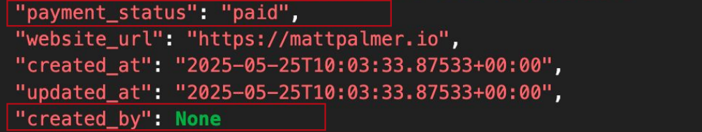
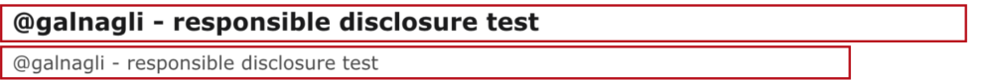
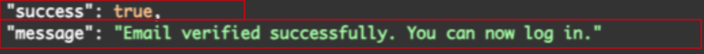
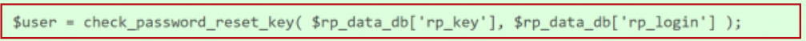
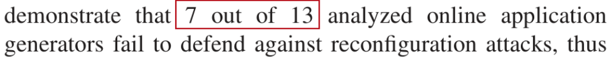
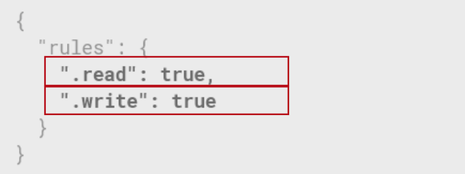

# App builders — evidence index

[← Project overview](../../README.md) · [All evidence](../README.md) · [Published sources](../../references/README.md)

Published disclosures and studies on ownership, payment state, platform authentication and shared generated code.

## Captures

| ID | Context | Source PDF |
| :--- | :--- | :--- |
| [app-builders-published-01](published-p02-f01.png) | published — linkable / payment state | [Page 2](../../reports/app_builders_security_research.pdf#page=2) |
| [app-builders-published-02](published-p03-f01.png) | published — moltbook / ownership | [Page 3](../../reports/app_builders_security_research.pdf#page=3) |
| [app-builders-published-03](published-p04-f01.png) | published — base44 / private access | [Page 4](../../reports/app_builders_security_research.pdf#page=4) |
| [app-builders-published-04](published-p06-f01.png) | published — wordpress / a ready-made form | [Page 6](../../reports/app_builders_security_research.pdf#page=6) |
| [app-builders-published-05](published-p07-f01.png) | published — android / shared generated code | [Page 7](../../reports/app_builders_security_research.pdf#page=7) |
| [app-builders-published-06](published-p08-f01.png) | published — firebase / deployment settings | [Page 8](../../reports/app_builders_security_research.pdf#page=8) |

## Gallery

app-builders-published-01 · linkable / payment state · page 2

app-builders-published-02 · moltbook / ownership · page 3

app-builders-published-03 · base44 / private access · page 4

app-builders-published-04 · wordpress / a ready-made form · page 6

app-builders-published-05 · android / shared generated code · page 7

app-builders-published-06 · firebase / deployment settings · page 8

