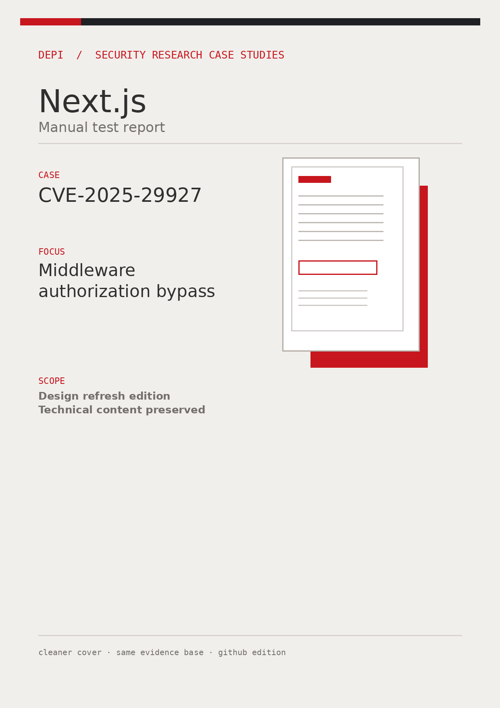
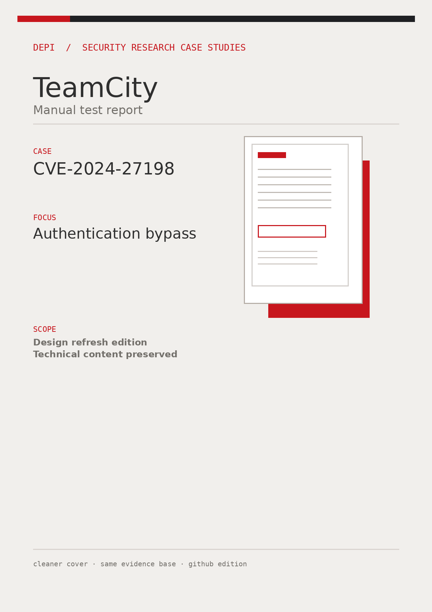
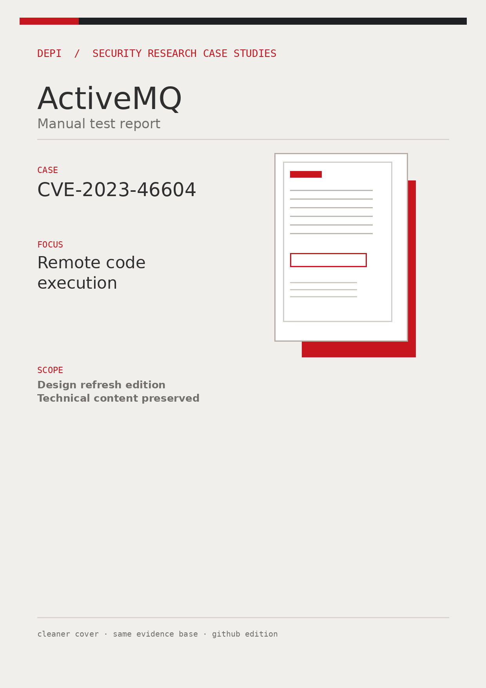
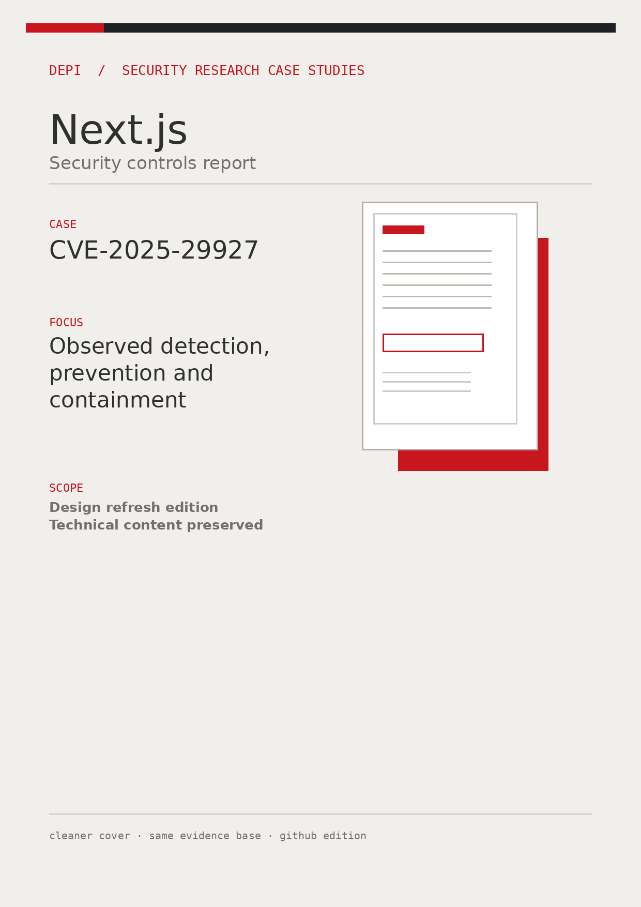
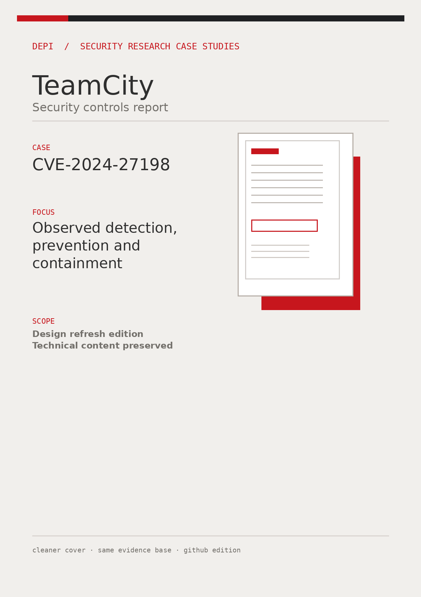
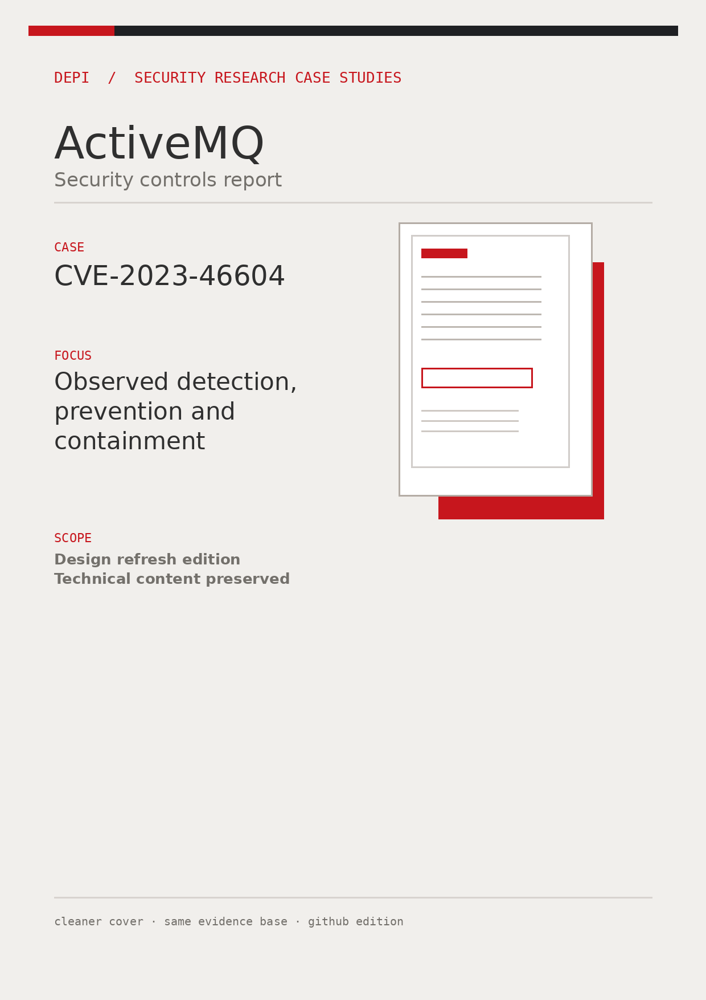

# Report library

Seven PDF reports. Covers were visually refreshed in this edition; internal findings and evidence pages were preserved.

[← Project overview](../README.md) · [Evidence library](../evidence/README.md) · [Published sources](../references/README.md) · [Lab setup](../labs/security-control-limits/) · [App-builder sources](../research/app-builders/)

The manual captures and control experiments are separate evidence sets. Compare outcomes within the configuration described by each report.

| Case | Manual exploit evidence | Security tool responses |
| :--- | :--- | :--- |
| **Next.js / CVE-2025-29927** | [Middleware bypass · 3 pages](nextjs_cve-2025-29927_report.pdf) | [Rules, decisions and fixes · 6 pages](nextjs_cve-2025-29927_security_controls.pdf) |
| **TeamCity / CVE-2024-27198** | [Authentication bypass · 3 pages](teamcity_cve-2024-27198_report.pdf) | [Rules, decisions and fixes · 6 pages](teamcity_cve-2024-27198_security_controls.pdf) |
| **ActiveMQ / CVE-2023-46604** | [Command execution · 3 pages](activemq_cve-2023-46604_report.pdf) | [Rules, decisions and fixes · 6 pages](activemq_cve-2023-46604_security_controls.pdf) |
| **App builders and generated code** | [Published research · 10 pages](app_builders_security_research.pdf) | Screenshots, study methods, fixes and references |

## Manual evidence

<table><tr>
<td width="33%" align="center"> <strong>Next.js</strong></td>
<td width="33%" align="center"> <strong>TeamCity</strong></td>
<td width="33%" align="center"> <strong>ActiveMQ</strong></td>
</tr></table>

## Control responses

<table><tr>
<td width="33%" align="center"> <strong>Next.js</strong></td>
<td width="33%" align="center"> <strong>TeamCity</strong></td>
<td width="33%" align="center"> <strong>ActiveMQ</strong></td>
</tr></table>